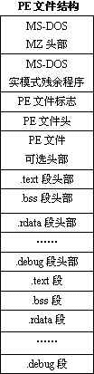
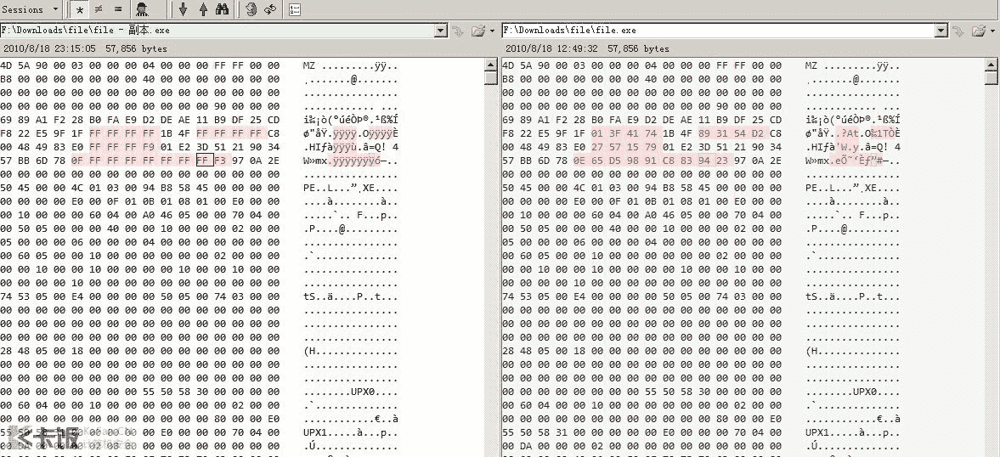

# 多态性 vs 云查杀

> 原文：[`www.pediy.com/kssd/pediy11/118767.html`](https://www.pediy.com/kssd/pediy11/118767.html)

多态性 vs 云查杀   
  
云查杀的基本原理是根据文件内容，通过某种算法计算文件唯一的函数值，以这个函数值（hash 值）作为文件的唯一标志，与数据库中的记录进行比较来确定文件可信度。  
我们看一下 norton power erase 的其中一条扫描记录  
\- <File ID="2">  
\- <File\_Information>  
<Path>F:\\RemindBook3\\RemindBook.exe</Path>  
<FileVersion>3.1.7.37</FileVersion>  
<ProductVersion>3.0</ProductVersion>  
<ProductName>RemindBook</ProductName>  
<Company>SnowFoxStudio.</Company>  
<Copyrights>Copyright(c)1998,2004 SnowFox Studio.</Copyrights>  
<MD5>273EB45D415A8E380EF5DD4E7BDBA82B</MD5>  
<SHA256>AB5F3ECDED67879472417B285B929FEE36F528D2049ACEE1651484C864EE6668</SHA256>  
<FileSize>6097408bytes</FileSize>  
</File\_Information>  
\- <SideEffects Count="1">  
<File>F:\\RemindBook3\\RemindBook.exe</File>  
</SideEffects>  
</File>  
  
可以看出所谓云查杀就是把  
1 计算出能确定文件的唯一的函数值（hash 值），为了确保唯一性尽量计算几种值  
如果是 md5 则能却分 256¹⁶ 个文件 sha256 能区分 256³² 个文件,文件大小(DWORD 4 个字节)区分为 256⁴ 个  
2 网络通信与数据库中的记录比较  
  
可见如果文件的大小，或者内容发生变化，则会造成唯一的函数值变化，如果不在数据库里，就不会被判断成病毒，只是可疑  
  
多态性指程序可以在运行时改变自身，或者存储代码表现不同，但基本功能性能一致。由于可执行文件文件结构为  
   
  
  
而可行性文件可通过  
1.  
简单修改 dos stub 或者 Ntheader 的位置  
  
2.  
文件末尾增加随机数  
3.  
增加修改区段  
来变更代码，而不影响功能性能  
  
可能使用到的 Api 有  
GetModuleFile  
CreateFile  
CtreatFileMapping、  
Cmd.exe   
/c xxxx  
MoveFileEx  
  
下面一个例子是 file.exe 被云查杀判断为病毒，可是只要随意修改其 dos stub 胡乱填写数据就行  
  
file.rar\[解压密码是：kill\_virus\]  
  
  
2010.8.18 23:32 上传下载 (240 KB)  
  
增加一个附件  
 file2.rar \[解压密码是：kill\_virus\]