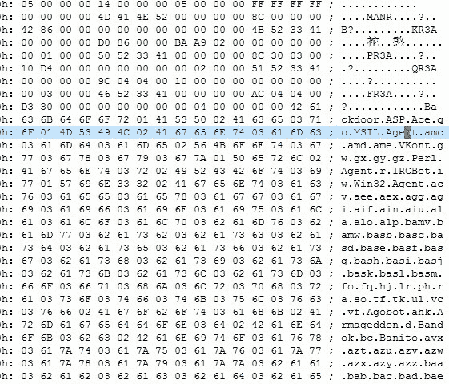

# 放个卡巴斯基的病毒库解密工具吧

> 原文：[`www.pediy.com/kssd/pediy12/129266.html`](https://www.pediy.com/kssd/pediy12/129266.html)

可以针对最新的卡巴斯基病毒库格式进行解密，把\*.kdc 病毒库文件的病毒记录和特征解出来  
下载地址[`www.mamushi.tk/tools/AVPBase\_parser.rar`](http://www.mamushi.tk/tools/AVPBase_parser.rar)，应用很简单，第一参  
数为病毒库目录，第二个参数为解密后存放的输出目录。  
  
解出来数据格式类似于以下格式  
  

上传的附件
|  || AVPBase\_parser.rar  
 |