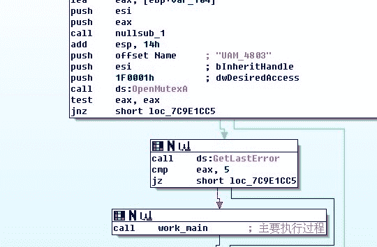
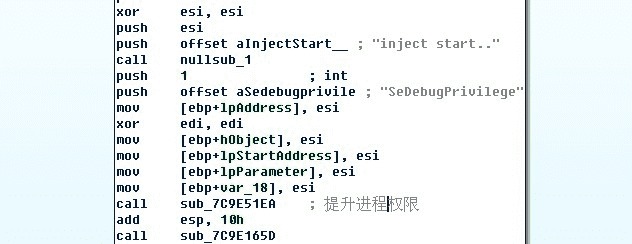
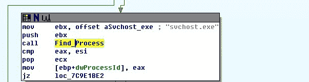
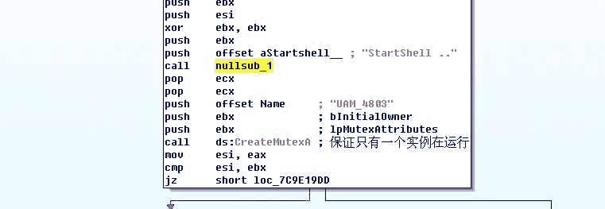
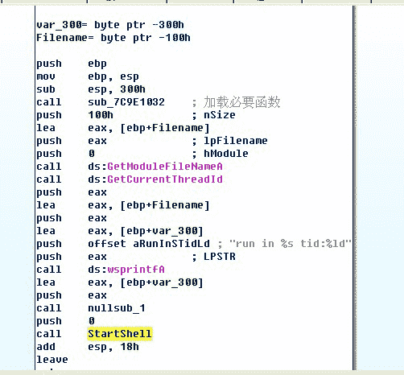
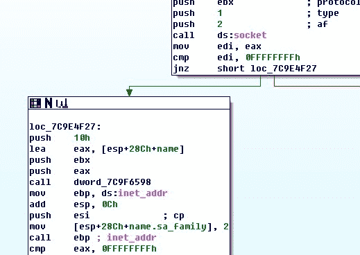
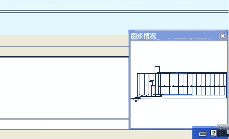
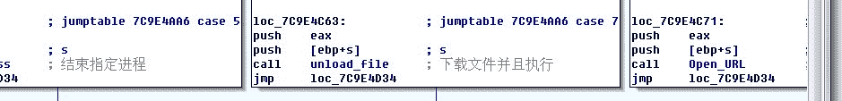

# Backdoor.Win32.UAManager.b

> 原文：[`www.pediy.com/kssd/pediy12/131305.html`](https://www.pediy.com/kssd/pediy12/131305.html)

此木马是一个 DLL，应该还有一个加载程序  
  
1.病毒运行后，会调用 CreateMutex 建立一个名为 UAM\_4803 互斥量，这样就保证系统中只有病毒的一个实例在运行  
  
  
  
2.通过调用 SeDebugPrivilege 等函数提升权限  
  
  
  
3.遍历进程对找到的第一个”svchost”进程，将自己将注入其内存，然后通过 CreateRemoteThread 启动其导出函数”Entry”。  
  
  
  
注入执行部分:  
  
1.通过尝试创建名为"UAM\_4803"的互斥量来检查驱动是否加载，如加载则不做其它操作。  
如果未加载则，注册服务,实现自启动驱动,并立即启动该服务  
  
  
  
  
  
2.启动工作线程，连接远程服务器，接受命令，执行, 实现远程监控功能。  
  
  
  
3.支持以下命令  
cmd 命令  
结束指定进程  
根据网址,下载文件（执行）  
打开指定网址  
设置主页  
浏览目录  
获得文件详细信息  
同服务器进行上传和下载文件  
打开,删除文件  
创建,删除目录  
清除日志  
桌面截图  
  
  
  
  
图片可能看的不清晰  
附上 IDB，里面部分已经注解  
求精华。。求声望。。  
  
本人决定从现在开始每周最少申精 2 篇。。。

上传的附件
|  || 病毒原本与 IDB.rar 解压密码：muma  
 |