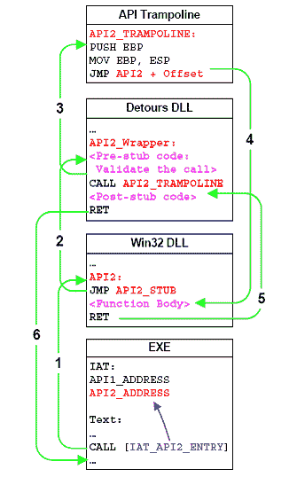
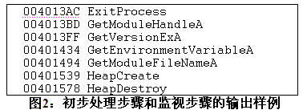
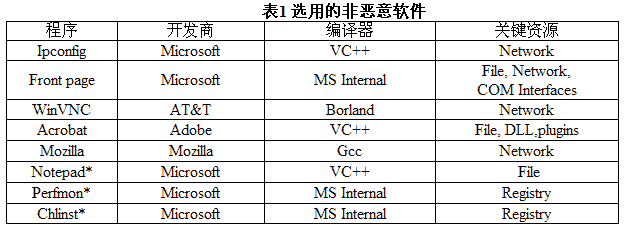
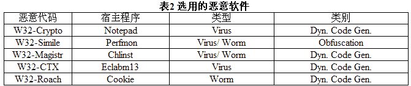
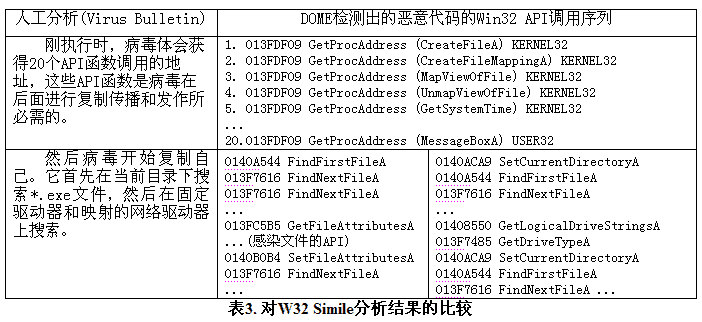

# 注入 动态生成及混淆的恶意代码的检测

> 原文：[`www.pediy.com/kssd/pediy08/pediy8-804.htm`](https://www.pediy.com/kssd/pediy08/pediy8-804.htm)

注入，动态生成及混淆的恶意代码的检测  
  
译者：aal  
  
摘要  
  
本文演示了 DOME, 它是一种检测宿主可执行文件中的恶意代码的技术。DOME 通过静态分析确定软件中产生系统调用的位置（虚拟地址），然后再监视软件运行并验证所有观察到的系统调用都是从静态分析时获得的地址处产生的。 这种技术简单，易行，实用，而且对注入，动态生成以及混淆的恶意代码都非常有效。  
  
类别和主题描述  
  
D.2.4 \[软件工程\]: 软件/程序验证－模块检查  
  
D.4.6 \[操作系统\]: 安全和保护 － 侵入式软件（如病毒，蠕虫，特洛伊木马），验证  
  
K.6.5 \[计算和信息系统管理\]: 安全和保护 － 侵入式软件（如病毒，蠕虫，特洛伊木马），验证  
  
基本术语  
  
算法，设计，安全，验证  
  
关键词  
  
恶意代码检测 入侵检测 异常检测 代码分析 静态分析 动态分析 系统调用 运行监视  
  
  
  
1. 简介  
  
本文演示了 DOME1，一种强大的基于宿主的检测技术，它能够保护软件不受下列几种恶意代码（MC）的破坏：   
   
  
•  注入的恶意代码，比如利用缓冲溢出漏洞将自身代码注入到运行中进程的蠕虫；  
•  动态生成的恶意代码，比如多态的病毒和木马，它们将自身代码加密后再存储，以此来阻止别人对它们的检测和分析，在运行时会先解密再执行。  
•  混淆的恶意代码，比如一些病毒，特洛伊木马和蠕虫，它们通过数据加工和模糊计算来伪装自身代码，从而防止自身被检测和分析。   
  
   
DOME 不是针对某一种特定类型的注入代码、动态生成代码或者是混淆代码的。 比如，它不仅能够检测之前已经发现的恶意代码，还能够检测新出现的恶意代码（比如刚刚出现的蠕虫）。 对于注入式的蠕虫，不管它是简单还是复杂，单线程还是多线程，快还是慢，明目张胆还是偷偷摸摸，没有攻击目标还是有攻击目标，单态还是多态，DOME 都可以起到保护作用。  
  
DOME 适用于不同的操作系统，我们的研究主要集中于 Microsoft Windows 2000 及更高版本中的标准可执行文件格式，也就是 Win32 Portable Executable File Format (PE) \[1\]，因为它是应用最广泛的系统，也是被恶意代码攻击最频繁的系统。  
  
DOME 的主要思想是先通过对文件进行初步处理来确定软件中 Win32 API2 调用的位置，并且在软件运行时验证所有观察到的 Win32 API 出现的位置是否都和初步处理中得到的位置相同。 这种技术的优点在于它简单，易行，实用，并对注入，动态生成及混淆的恶意代码非常有效。  
  
研究发现，对于典型的编译器生成的文件，简单的静态分析就可以可靠地分析出其中正常的 Win32 API 调用的位置， 但是对于这三种恶意代码，却不能通过初步处理得到其中 Win32 API 调用的位置。 对于注入的恶意代码，它对 Win32 API 的调用不可能在对软件的初步处理中得到，是因为这种恶意代码是在软件运行期间才注入软件进程的，所以在软件的初步处理中肯定没有这些调用。 对于动态生成和混淆地恶意代码，它们的 Win32 API 调用也不能在对软件的初步处理中得到，是因为 DOME 定位 Win32 API 调用的程序不会模拟运行时的代码生成，也不会试图去理清故意混淆的代码。   
  
我们的技术在检测这些实际软件中常见的主要几种恶意代码方面是独一无二的，理论上不会有误报或者漏报，运行期间的监视所带来的消耗也很小－每个 API 调用会减慢大概 5％。   
  
应用于宿主机器时，DOME 会监视指定文件的运行并在其间发现恶意代码。 这个检测是在恶意代码还没有机会与操作系统接触之前进行的，也就是说，恶意代码在感染操作系统的受保护资源，比如文件、套接字之前就会被发现。 因为恶意代码在进行任何破坏前就被终止了，DOME 也就保护了宿主不受恶意代码的感染。  
  
注意 DOME 不仅仅能够检测到恶意代码，它实际上是检测到了恶意代码中进行 Win32 API 调用的部分。 这个信息可以作为进一步研究恶意代码的起点，能够帮助理解并回应恶意代码攻击。  
  
  
  
1.DOME 是“Detection of Malicious Executables”（恶意可执行文件检测）的简写。  
  
2.Win32 API 函数是 Microsoft Windows 操作系统(OS)标准库函数. 我们假设恶意代码通过 Win32 API 函数与系统进行交互。  
  
  
对于嵌入在软件中的恶意可执行代码，因为它们要隐藏自己以避免被检测和分析，DOME 正是利用恶意代码的这个特性来检测它。 因此 DOME 不能检测非混淆的病毒和特洛伊，因为它们的代码在 DOME 对软件进行初步处理之前就已经嵌入了文件。 更进一步说，DOME 只能检测使用了 Win32 函数的恶意代码，对那些通过破坏，崩溃或使被感染文件挂起而造成破坏的恶意代码不起作用。 另外，DOME 对不使用代码注入技术的蠕虫不起作用，比如脚本蠕虫和通过社会工程学渗透并通过驱动器共享进行传播的蠕虫。 要想确保得到针对恶意代码的全面保护，基于 DOME 的系统必须同时使用针对 DOME 所不能应对的几种恶意代码的检测系统。   
  
本文下面是这样安排的： 第二部分定义了 DOME 所覆盖的几种恶意代码。 第三部分描述了 DOME 技术. 第四部分是一个评定实现 DOME 的可行性以及 DOME 检测恶意代码能力的研究的报告. 第五部分考虑了 DOME 可以使用的几种不同配置. 第六部分讨论了相关工作,第七部分是结论。  
  
   
  
2. 覆盖范围  
  
   
  
DOME 适于以下三种恶意代码:  
  
1. 注入式的代码 – 运行期间注入某个进程地址的代码  
  
2. 动态生成的代码 – 运行期间才生成的代码.  
  
3. 混淆代码 – 在进程的原始代码中就已经存在,但是代码的真实目的却通过混淆计算和数据加  
  
工隐藏起来了 3。  
  
大部分使用缓冲溢出漏洞将自己注入到程序进程的蠕虫都属于第 1 类。将自己的代码加密并嵌入磁盘上的可执行文件中的多态病毒属于第 2 类。与动态代码生成类似,代码混淆经常用于病毒和木马,而不是蠕虫；但是,下一代的蠕虫很有可能通过这些复杂的技术来防止自己被检测和分析。覆盖范围通过下面的前提假设进一步具体化：  
  
假设 1: 任何注入的,动态生成的,和混淆的代码都是恶意代码.   
  
这个假设是有道理的,因为这类代码在一般的非恶意软件中不会出现. 注入代码尤其如此。 混淆代码有时在正常的软件中用到，来保护私有算法和软件不被分析。动态生成的代码有时也会在正常软件中见到。这类代码包括：堆栈中的跳转,使用嵌入函数；实时编译器，用字节代码生成本地机代码;可执行文件解压缩,运行期间解压存储于磁盘中压缩的可执行代码。 我们未来的工作中会研究如何使 DOME 包含这些特殊情况。  
  
假设 2: 恶意代码与系统进行交互.   
  
大部分的恶意代码活动,比如访问网路或文件服务,都需要与系统进行交互;其他人比如\[2,3.\]已经得出了相同的结论. 但是一些恶意代码,比如拒绝服务和破坏数据,可能不需要与系统交互就能够完成；仅进行这些活动的恶意代码不能够被 DOME 检测到.   
  
假设 3: 恶意代码与系统进行交互时使用 Win32 API.   
  
不使用 Win32 API 而使用 Windows 本地 API 与系统交互是可能的。DOME 可以通过扩展来包含这种类型。 还有一种解决方案就是将所有 Windows NT 本地 API 都认为是恶意的。  
  
假设 4: 恶意代码为了自身不被检测和分析使用动态代码隐藏自身代码时，对 Win32 API 的调用被隐藏了起来.   
  
因为恶意代码使用的 Win32 API 调用能够反映出恶意代码的目的和工作原理,所以如果恶意代码要防止被检测和分析，隐藏其对 Win32 API 的调用是很有道理的。隐藏主要是通过动态代码生成或者代码混淆来完成的。一种常见的混淆技术是使用复杂的计算或在内存中进行代码扫描来确定其所需的 API 函数的地址或名称。另一种技术是通过非常规手段使用动态绑定函数(比如 GetProcAddress)。  
  
   
  
  
3.这个定义不如前两个清楚。假设 4 中对这里的“混淆”的意思做了澄清。  
  
假设 5:待保护软件可以被成功的反汇编,其中使用的 Win32 API 可以在运行期间被有效的监视。  
  
我们认为大部分编译器生成的软件都符合这个条件。  
  
   
  
3. 检测技术  
  
   
  
DOME 核心分两步防止受保护的软件被恶意代码破坏.  
  
1. 处理所有的可执行文件,确定其中的 Win32 API 调用指令,并将它们的虚拟地址和函数名称存储起来.  
  
2. 在软件运行期间监视软件对 Win32 API 的调用，当一个 Win32 API 被调用的时候,确定产生调用的指令和该指令在文件中的地址. 然后,验证这个指令的地址和所调用的 API 函数名称时候是否与初步处理过程中得到的地址一致. 如果发现不一致,则发出警告 4。这时，系统就可以通过阻挡该 API 调用保护宿主。  
  
我们还假设软件在初步处理后不曾发生过变化。如果软件升级了，初步处理过程必须重新进行。初步处理后的病毒感染造成的文件改变很容易通过完整性校验发现,比如基于 MD5 和 SHA-1 的校验。   
  
以上的介绍说明了为什么 DOME 能够成功检测注入代码,动态生成代码和混淆代码。现在我们详细地描述一下 DOME 的两个步骤，然后在思考一下如何扩展 DOME 使其能够处理利用 DOME 原理试图逃过 DOME 检查的恶意代码。  
  
3.1 初步处理  
  
初步处理这一步中，DOME 对软件反汇编，然后分析确定调用 Win32 API 的指令。这些指令的地址和 API 函数名会被记录下来。因为某些原因(下一部分会讲清楚)，我们还记录 Win32 API 调用后面的那句指令的地址，也就是 Win32 API 调用的返回地址，当调用要返回时，这些地址应该出现在堆栈的最顶端。   
  
通过这样的识别机制，我们就区分出了运行期间正常的 Win32 API 调用和恶意代码的 Win32 API 调用。 即这种识别机制应该能够找到正常编译器生成的代码产生的 Win32 API 调用，忽略那些有意隐藏自身的调用。 幸运的是，设计这样一种识别机制是很简单直接的，因为正常代码对 Win32 API 的调用方式与有意混淆自己代码对 Win32 API 的调用方式有着明显的不同。   
  
在编译器生成的正常代码中，Win32 API 的调用是通过引用输入地址表（IAT）中的相应条目来实现的。 这些调用要么直接引用 IAT，形如”call \[IAT Entry 4\]”,要么就是间接引用，而间接引用也可以通过静态分析来识别。   
  
比如，常见的优化后的 Win32 API 调用先将 API 的对应的 IAT 条目载入到某个寄存器，然后再产生一个引用该寄存器的调用。 由调用产生的地方向回追溯寄存器中的值就可以确定这个 call 指令是用来调用哪个 API 的。   
  
静态分析也能确定后期绑定的 Win32 API 的调用，即那些在运行期间使用 GetProcAddress 来获得地址的 API。当发现对 GetProcAddress 的调用时，待绑定地址的 Win32 API 函数的名称肯定已经存储在了某个寄存器或者某个内存地址中。   
  
为了应用于实际软件，初步处理步骤应该处理由多个可执行模块构成的软件，比如包含自定义的 DLL 文件的软件。  
  
3.2 监视和检测  
  
这一步用来监视软件进程产生的 Win32 API 调用并验证产生调用的指令地址和所调用的  
  
   
4 DOME 还有一个不含初步处理步骤的版本：它在软件运行期间监视 Win32 API 调用然后判断磁盘文件中的相应地址处是否有该函数的调用。这个版本运行期间会产生更大的消耗，并且也不够精确。  
  
   
  
函数名称是否与初步处理中所得到的信息相对应。 这一步逻辑上分为两部分： 即监视 Win32 API 调用和将该调用的信息和初步处理中所记录的信息相比较。  
  
   
  
Win32 API 调用的监视： 监视 Win32 API 调用有几种方法\[4\]。在我们所作的验证试验研究中，我们使用的是 Detours 包\[5\]中提供的直接修改的方法，即在载入期间改造包含调用 Win32 API 的 DLL 的方法。 通过直接修改每个 Win32 API 调用的入口点，所有的 Win32 API 调用都可以监视到。 载入期间修改 DLL 文件我们能够有选择的监视可执行文件。   
  
     
 ** 图 1：Detour 处理过的 API 调用**  
  
图 1 说明了使用 Detours 修改了 API 后，软件进程对一个 Win32 API 的调用是如何完成的。 进程产生一个对 API 函数的调用（1），该 API 函数地址的第一条指令已经是一个指向 Detours 外壳的条件跳转。外壳可能会先执行一段初步处理代码，然后再将控制权交给 Win32 API 函数体（3 和 4）。 Win32 API 函数执行完毕后会再次返回 Detour（5），这时可以再执行一段后处理代码，然后再将控制权交还给调用者（6）。 初步处理代码处，DOME 就可以验证 Win32 API 函数调用信息是否与初步处理的信息相同。 与初步处理类似，监视步骤也应该能够处理多个可执行模块构成的软件。  
  
  
  
   
  
Win32 API 调用的验证： 正如前面提到的，Win32 API 调用的验证是在 API 的 Detour 外壳初步处理代码段中完成的。 Win32 API 调用一发生，初步处理代码就会首先取得控制权，此时堆栈的顶端应该是该调用返回地址。 要验证这个调用，DOME 首先看这个返回地址和函数名称在初步处理步骤中存在。 如果存在，外壳程序将控制权转移给 Win32 API 函数体，否则就报警。 为了处理 DLL 重定位的情况，这在两个或多个 DLL 都要装载到同一地址的时候经常出现，DOME 使用的指令地址是相对于 DLL 基址的相对地址。  
  
   
  
3.3 处理被跳过的可能性  
  
   
  
至此，DOME 还是很简单的最基本的版本，但是对于检测它所覆盖范围大部分恶意代码已经很有效了。 主要的例外就是那些刻意要绕过 DOME 以及/或者底层监视技术的恶意代码.为了能够处理这类恶意代码，DOME 需要进一步扩展。 我们给出了大概思路，并且会将其列为以后工作的一部分。  
  
DOME 被跳过的可能性：恶意代码试图跳过 DOME 有几种方法，一种就是伪造运行期间堆栈栈顶的地址，使其看起来好像是从静态分析时得到的某个地址出产生的。另一种方法就是使用软件本身含有的 Win32 API 调用指令，但传递的参数却是恶意代码的参数。 当然也有不少方法来对付这种攻击。 其中两个不错的办法就是初步处理时识别和记录静态 Win32 API 的参数，然后在运行期间对它们也进行验证及运行期间堆栈验证。  
  
外壳程序被跳过的可能性：任何在用户模式下实现的 API 外壳系统都可能被跳过。 特别当恶意代码设计时就已经考虑到了使用 Detour 技术的检测系统时，它可以对内存作些手脚从而使 API 调用前的外壳程序失效。 另外，恶意代码可能会直接调用内核代码，避免使用 Win32 API 调用进而躲过外层程序。 在 IA32 系统中，直接调用内核代码依靠于通过中断引发的特权提高或者是使用 sysenter 指令。 因此另一种避免外壳程序被跳过的方法就是添加内核级的验证机制来确保 API 通过未被修改过的外壳程序的检查后才被调用。  
  
   
  
4. 试验验证研究  
  
   
  
为了证实 DOME 的可行性和验证它检测恶意代码的能力，我们进行了验证试验。该研究是为了特意验证下列三条设想而进行的：   
  
1. 使用静态分析定位实际软件中的 API 调用是可能的。  
  
2. 在运行期间监视 API 调用并且定位产生所观测到的 API 调用的指令是可能的。  
  
3. 如果上面两点都能实现，DOME 能够准确的分辨出正常代码和注入的，动态生成的或是混淆的代码。  
  
  
   
  
图 2：初步处理步骤和监视步骤的输出样例  
  
初步处理是使用 IDA Pro 反汇编工具完成的\[7\]，它不仅可以反汇编可执行文件，还能够识别出调用 Win32 API 的指令并进行标注。监视是通过 Detours 开发包实现的。每一步都会生成一个文件，其中包含了 API 调用地址等，如图 2。 然后通过与输出文件比较，发现那些运行期间调用而初步处理时却没有出现的 API 函数。   
  
我们分别在若干非恶意软件，被嵌入了恶意代码的非恶意软件及在运行期间被注入了恶意代码的非恶意软件上对 DOME 进行了评估。  
  
   
  
4.1 非恶意软件  
  
表 1 列出了我们的试验中使用的非恶意软件。 其中包括了使用不同的编译器以及涉及到了各种不同资源（比如网络和文件系统）的软件。   
  
  
   
  
这些试验都很成功。 我们没有发现任何意料之外的 API 调用。唯一的误报是由于 API 函数的动态绑定造成的，这种情况早在我们的意料之中，因为 IDA PRO 的静态分析无法处理这种情况。  
   
  
  
  
  
  
4.2 恶意代码样本  
  
表 2 的恶意代码列表中包括了使用了动态生成（多态）技术，混淆技术和代码注入技术的病毒和蠕虫。   
  
对于每一个样本，在验证试验中都成功的监测到了恶意代码对 API 的调用。 验证试验生成的列表包含了所有运行期间产生而初步处理过程中却未发现的 Win32API 调用。 这个列表在某些程度上“讲述”了恶意代码是如何工作的，所以这些信息可以用来进一步分析恶意代码，然后写出可理解的恶意代码的描述。表 3 以图表的形式展示了对一个感染了 W32-Simile 病毒的跟踪结果，而 Virus Bulletin\[8\]上对该病毒的分析结果中说到  
  
W32-Simile 经过了高度的混淆处理，非常难以理解。 该病毒能够对抗反汇编，反调试以及反仿真技术，以及标准的基于评估的病毒分析技术。 和许多其他病毒一样，Simile 还使用了\[入口代码混淆\]EPO 技术。  
  
从表 3 可以看出，DOME 的输出与这些人工手段写出的对 W32-Simile 的描述十分吻合，而这个输出是没有经过任何人工引导生成的。  
  
4.3 总体性能  
  
已我们的经验，在 600MHz Pentium 的机器上，IDA Pro 可以以约 5KB/s 速度队可执行文件进行静态分析。 Detours 外科程序会为每个 API 调用增加额外%5 的消耗，这与文献\[5\]中的描述是一致的。  
  
  
\* 我们的恶意代码的样本嵌入了这些程序，所以我们也分析了这些程序的原始文件，从而证明我们的系统识别出的 API 调用都是由恶意代码产生的。  
  
   
  
  
   
  
5. 配置选项  
  
   
  
DOME 主要被设计为基于宿主的能够监视和保护软件的在线检测技术。但是，这个技术也可用于离线扫描器和恶意代码分析工具中，用来监测可执行文件中的动态生成和混淆代码。  
  
   
  
5.1 离线监测和阻挡  
  
本例中，DOME 可以用来初步处理和监视指定软件，检测和制止在其运行期间侵入的蠕虫以及在初步处理之前嵌入文件的动态生成和混淆的恶意代码。对于经过了初步处理的文件，DOME 检测其中的简单病毒和复杂病毒一样有效；但是文件的这种变化可以使用更简单的找到，比如可以比较可执行文件当前的与最初的 hash 值。  
  
在实际的实现方案中，初步处理和监视都可以有几种不同的方法实现。 可以对所有文件的进行初步处理，也可以只对选定的文件进行初步处理，可以对安装的每一份拷贝分别进行，也可以对由站点管理员、软件生产商或可信任的第三方安装的一整套安装同时进行。 监视 Win32 API 调用可以对每个可执行文件施行，也可以通过重写 DLL 文件在系统范围内施行。  
  
正如前面提到的，一些软件使用了混淆代码保护自己的算法或者保护软件不被逆向分析。 如果这种软件需要使用 DOME 保护，管理员可以在系统设置时或者系统运行时将这些 API 调用标记为合法。同理，在军用和政府工作环境中，可以要求含有混淆代码的软件附带比如关于软件行为的说明书之类的东西，其中就可以包括软件使用的 API 函数及调用地址的列表。   
  
   
  
如果一个新软件没有经过初步处理就运行了，我们可以使用另一种方案：每当文件要进行 API 调用时，保护系统就读取磁盘文件上相应的代码并进行静态分析，从而确定该地址是否有该 API 调用（结果可以暂存起来）。 如果没有，系统就可以发出警告，并阻止该 API 调用。 运行期间的本地代码分析会产生额外的开销，而且也很可能不如初步处理中的静态分析准确。  
  
对网络中迅速传播的蠕虫最有效的防治方法就是在每台机器上都配置 DOME 系统。这样就可以保护网络，防止一个仅通过一到三轮的传播就可以使整个网络瘫痪的蠕虫不能迅速传播。  
  
为了保证对恶意代码完全防范，基于 DOME 的系统还应该同时使用另外一些检测系统来针对 DOME 所不覆盖的病毒，其中包括脚本和社会工程学蠕虫。DOME 还可以用于蜜罐\[9\]以监视网络服务并辅助对蠕虫攻击的监测和分析。  
  
5.2 离线软件扫描  
  
DOME 技术还被用于反病毒式的扫描器中。这种扫描器可以初步处理指定软件的可执行文件，然后启动文件检查它是否会在未被定位的地址出产生 Win32 API 调用。  
  
要实现完全扫描，可执行文件需要沿着所有可能的程序流程运行一遍；但是驱动程序执行流程的问题是一个很复杂的话题，而且目前也没有可行的独立于具体程序的解决方案。一个可行的办法是启动程序然后过一小段时间再终止程序。每次宿主文件启动时，恶意代码只要至少执行一个 Win32 API 调用，这种方法就可以检测到。这是典型的恶意代码都具备的特征，而且与我们的试验验证中所观察到的也是一致的。 比如，在某个特定时间才会发作的病毒，它会在每次宿主文件执行的时候调用一个时间 API 函数来检验是不是满足发作的条件。  
  
为了确保宿主系统不在扫描时被感染，被确认为是恶意的 Win32 API 的调用会被终止。  
  
5.3 在线和离线分析  
  
DOME 不只是检测恶意代码，它实际上检测到了属于恶意代码的指令。在线或离线工具可以使用这个信息对恶意代码进行分离和分析。这类分析的目的可能是检测签名和防火墙规则，分析代码和触发机制，预知传播携带者或者恶意代码的血统和归属。DOME 还可以用来生成可读的恶意代码工作原理的描述。  
  
   
  
6. 相关工作  
  
   
  
检测恶意代码的方法可以归为以下两类： 恶意检测和非正常检测。（aal：此处译得比较模糊）恶意检测定义的是“恶意行为”。它试图找出那些定义为恶意的代码特征和/或运行时行为。与恶意检测方案不同的是，非正常检测定义的是“正常行为”，它试图确定那些与正常（即非恶意）行为相背离的代码特征和/或运行时行为。  
  
DOME 技术属于非正常检测。运行期间的正常行为是指在初步处理中所识别出来的产生的 Win32 API 调用的地址。  
  
许多现有的非正常检测，比如\[3, 10-14\], 是根据运行时的系统调用序列来生成正常行为模块；Feng 等人\[10\]提供了一个这方面技术的全面介绍。与此相对，DOME 使用的不是系统调用序列。 它独一无二的使用了产生系统调用的指令的地址作为其正常行为模块。 这种模块的优点是简单，使用，有效。  
  
大部分的非正常检测技术，尤其是\[10, 11, 13, 14\]中提到的那些技术，通过监视软件运行生成正常行为模块。 这一步之后，他们就转向了下一步即非正常检测，其间他们会继续监视软件的运行，进一步寻找那些不在行为模块中的行为。  
  
这种技术的一个缺点就是其模块中只包含了在检测阶段获得的行为，而这些行为通常只是软件所能表现的行为的一小部分。未得到的行为若在非正常检测中出现将会产生误报\[15\]。DOME 就没有这些限制，因为它的模块中包含了文件可能在运行时产生的所有非恶意的系统调用；这样，DOME 理论上是不存在误报的。  
  
另外，与基于观察的非正常检测不同，DOME 提供了一个更广泛的覆盖范围。基于观察的系统目的是通过检测获取了正常行为模块后在非正常检测阶段中发生的恶意代码指令。而 DOME 不仅能够检测到在运行期间注入的恶意代码，还能够检测到在初步处理之前就已经嵌入到可执行文件的复杂的恶意代码。  
  
与 DOME 类似，Wagner 等人的技术\[3\]和 Giffin 等人\[12\]通过对软件静态分析构建软件的正常行为模块。Wagner 等人\[3\]的技术通过源代码实现，并且作了一些简化处理从而忽略了源代码的复杂性。这种技术构建一个软件的全局控制流程图，然后再将图转化成一个不确定的自动机（aal：nondeterministic finite state automaton (NFA)不知道是什么！）或者一个不确定的下压自动机（同前：nondeterministic pushdown automaton (NPDA)），使软件可能进行的系统调用序列模块化。 这些模块非常复杂，而以难以确定它们是否可以用于实际软件；而且因为自动机的不确定性所以监视耗费巨大。 而且不确定自动机有一个根本问题：它包含了软件中不存在的调用序列，如果恶意代码恰好产生了这个序列，它也不能检测到。不确定下压自动机模型针对不精确的问题将运行时的堆栈的一个精简版本包含在了模块中，但是这个扩展式模型更加复杂，最后的结果是耗费过大更加不实用。Giffin 等人的技术是针对移动代码安全开发的，比如远程过程调用\[12\]。它运行于可执行代码生成与 Wagner 等人的 NFA 相类似的模型。 作者建议使用几种程序转换技术来减少不确定程度以及使模块更加精确；这样的转化可能适用于移动代码，但是因为合法和协同性问题似乎不适用于传统的基于宿主的软件。  
  
   
  
7. 总结  
  
   
  
我们演示了 DOME，一种检测软件中的注入，动态生成，和混淆的恶意代码技术。我们的实验证明 DOME 检测恶意代码的效率很高。DOME 的主要思想使适用静态分析确定软件中 Win32 API 调用的地址，然后用这些地址作为运行期间允许发生的 Win32 API 调用的模块。基本模块可以通过几种不同的方法被扩展来应对恶意代码试图对 DOME 的躲避；模块中还很可能包含的一个思想是将 Win32API 调用的参数也包含进去。 我们将会继续深入，在我们未来的工作中加入更多功能，那时我们会实现和评估基于 DOME 的在线检测系统。  
  
   
  
8. 参考文献  
  
   
  
\[1\] Pietrek, M. Inside Windows: An In-Depth Look into the Win32 Portable Executable File Format (Part I). In www.msdn.microsoft.com. 2002.  
  
\[2\] Bergeron, J., M. Debbabi, M.M. Erhioui, and B. Ktari. Static Analysis of Binary Code to Isolate Malicious Behaviours. In WET ICE 99. 1999.  
  
\[3\] Wagner, and Dean. Intrusion Detection via Static Analysis. In IEEE Symposium on Research in Security and Privacy. 2001. Oakland, CA.  
  
\[4\] Kaplan, Y. API Spying Techniques for Windows 9x, NT and 2000. http://www.internals.com/articles/apispy/apispy.htm  
  
\[5\] G. Hunt, D.B., Detours: Binary Interception of Win32 Functions. 1999, Microsoft Research.  
  
\[6\] Wagner, D., and P. Soto. Mimicry Attacks on Host Based Intrusion Detection Systems. In 9th ACM Conference on Computer and Communications Security. 2002. Washington, DC, USA.  
  
\[7\] Data Rescue. IDA Pro Disassembler. http://www.datarescue.com/idabase/  
  
\[8\] Frédéric Perriot, P.F., Péter Ször, Striking Similarities, in Virus Bulletin. 2002. p. 4-6.  
  
\[9\] Tünnissen, J. Intrusion Detection, Honeypots & Incident Response resources. http://www.honeypots.net/  
  
\[10\] Feng, H., O. Kolesnikov, P. Fogla, W. Lee, and W. Gong. Anomaly Detection Using Call Stack Information. In IEEE Security and Privacy. 2003. Oakland, CA.  
  
\[11\] Sekar, R., A. Gupta, J. Frullo, T. Shanbhag, A. Tiwari, H. Yang, and S. Zhou. Specification-Based Anomaly Detection: A New Approach for Detecting Network Intrusions. 2002. Washington, DC, USA.  
  
\[12\] Giffin, J.T., S. Jha, and B.P. Miller. Detecting Manipulated Remote Call Streams. In 11th USENIX Security Symposium. 2002.  
  
\[13\] Ghosh, A.K., A. Schwartzbard, and M. Schatz. Learning Program Behavious Profiles for Intrusion Detection. In Usenix Workshop on Intrusion Detection and Network Monitoring. 1999. Santa Clara, CA.  
  
\[14\] Warrender, C., S. Forrest, and B. Pearlmutter. Detecting Intrusions Using System Calls: Alternative Data Models. In IEEE Symposium on Security and Privacy. 1999.  
  
\[15\] Axelsson, S. The Base-Rate Fallacy and Its Implications for the Difficulty of Intrusion Detection. In ACM Conference on Computer and Communications Security.1999. 

 4dd466d0e1e0cc123afbe504da2462ca