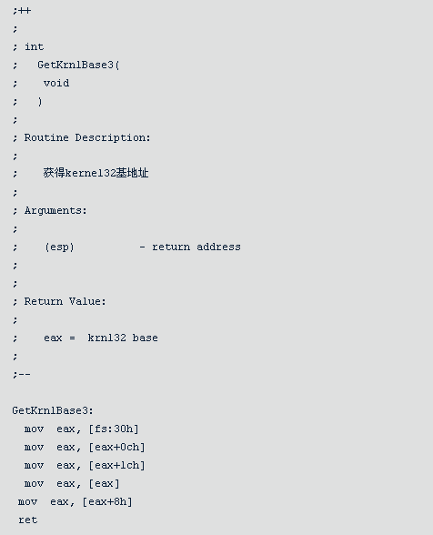
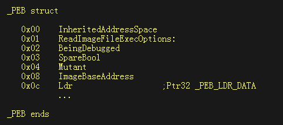
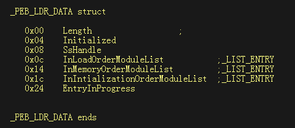
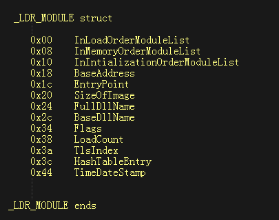
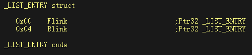
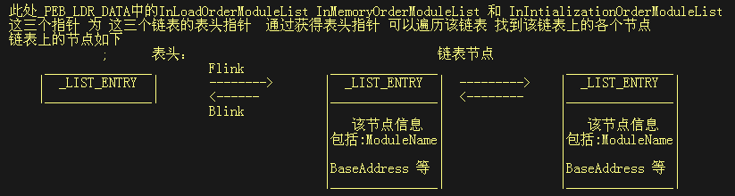
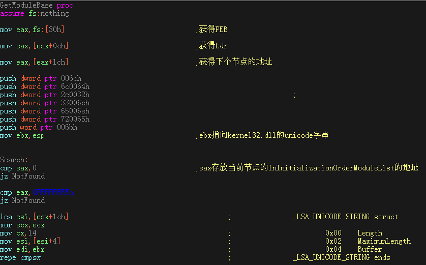
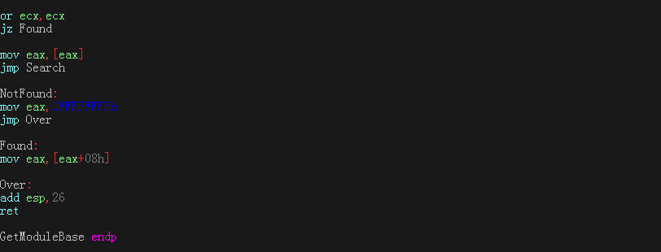

# windows 7 下的病毒感染

> 原文：[`www.pediy.com/kssd/pediy11/125526.html`](https://www.pediy.com/kssd/pediy11/125526.html)

这个是在 XFish 的病毒专题的基础上进行的简单探索。Windows 7 上面有很多有趣的地方，对安全研究有很大的意义。这两周有些心得，想跟大家分享一下，这里仅仅探讨一下 Windows 7 下面的病毒感染。  
  
一、Kernel32 基址的获得  
 XFish 专题中提到了三种方式，具体参见：[`bbs.pediy.com/showthread.php?t=85910`](http://bbs.pediy.com/showthread.php?t=85910)  
  
这里直接引用 XFish 的帖子：  
1. 通过线程初始化时, 获得 esp 堆栈指针中的 ExitThread 函数的地址，然后通过搜索获得 kernel32.dll 的基地址。      
2. 遍历 seh 异常链，然后获得 EXCEPTION\_REGISTRATION 结构 prev 为-1 的异常处理过程地址，这个异常处理过程地址是位于 kernel32.dll，通过它搜索得到 kernel32.dll 的基地址。  
3. 通过 TEB 获得 PEB 结构地址，然后再获得 PEB\_LDR\_DATA 结构地址，然后遍历模块列表，查找 kernel32.dll 模块的基地址。  
  
我将讨论下，现实中如果要感染 windows 7 的做法。  
第一种通过线程初始化的方式，一般来说，病毒代码很难在线程初始化的时候得到执行。你可能会说，直接修改 PE 入口点，指向你的病毒代码。据我所知，这样会直接被杀软干掉的。所以现实中不具有可行性。现实中的病毒代码会通过 EPO 技术，感染文件。即替换任意一个 call 的目标地址，让它调用自己的病毒代码，并在病毒代码的结尾跳转到被替换的目标代码中执行。这种技术对抗杀软非常有效。  
第二种方法和第三种方法在 windows xp 下都是很好的查找 kernel32 基址的方法。而且在 windows xp 下我更偏爱第二种。因为第二种通过 TEB,由 fs:\[0\]指向，和 windows 的 SEH 机制非常相似。杀软很难通过特征码判断出来。而第三种通过 PEB,由 fs:\[30h\]指向，正常程序应该很少操作 fs:\[30h\]。杀软很容易将其列为特征码。  
但是，这些仅仅是在 windows xp 下。  
在 windows 7 下，第二种方法是没有效果的。因为异常处理过程不再位于 kernel32.dll 当中，而是位于 ntdll.dll 中。你写一个程序用 OD 加载后查看下 SEH 链就明白了。  
只能使用第三种方法。  
XFish 提供的第三种方式的代码如下：  
  
这段代码十分简洁漂亮。  
但是如果你尝试在 windows 7 下面直接用，你会很遗憾的发现你的病毒代码运行不是很正常。因为这段代码基于的假设是系统初始化 dll 的顺序是 ntdll.dll-->kernel32.dll-->其他 dll。  
在 windows 7 下面系统初始化 dll 的顺序变成了 ntdll.dll-->kernelBase.dll-->kernel32.dll-->其他 dll。  
我现在暂时未弄清楚 kernelBase.dll 的作用（听名字好像和 ASLR 有关？？额，哪位大哥能指点一下？）。  
如果你的病毒试图在 windows xp 和 windows 7 下都能正常感染，要么通过判断 OS 类型（但是你还没有 GetProcAddress 函数，所以你貌似没辙），要么使用第三种感染方式，只不过我们要弄清楚第三种的原理。  
XFish 的帖子中已经很详尽地解释了第三种得到基址的原理。这里我借用一下。总体思路是通过 PEB，获得加载模块的链表。  
涉及的数据结构如下：  
  
Ldr 是\_PEB\_LDR\_DATA 的指针。而\_PEB\_LDR\_DATA 就是加载模块链表的头节点。  
  
你肯定知道\_LIST\_ENTRY 就是链表结构体，将我们链表中的各个节点连接起来。  
我们链表中的节点是啥样子的？如下：  
  
怎么连的？那个\_LIST\_ENTRY 结构如下：  
  
整个链表的结构如下：  
  
为了病毒能在 windows xp 和 windows 7 下面都能运行，只要将 BaseDllName 与 kernel32.dll 进行比较就行了。注意这里是进行 unicode 的字串比较。提供代码如下：  
  
  
附件是可运行的代码：  
VirusTest2.rar \[解压密码是：test123\]